# vm-tuneup-morpheus-plugin

**We've migrated to HVM. Now what?** VM Tune-Up grades every virtual machine on your HPE Morpheus HVM (HPE Virtual Machine) clusters, migrated or not. Whatever tool you used to migrate, and whenever you did it, see what it left behind and what to tune next: disks on emulated SATA or IDE, e1000 network adapters, the Legacy chipset, a QEMU guest agent that doesn't answer, VMware Tools still running, VMs that can't fail over, a cluster CPU setting your hosts can't all run, old snapshots, attached ISOs and more. Every VM gets a grade and a **tune-up plan**: what to do, in what order, in how few maintenance windows, and the grade it will have afterward.


[](../../releases)
[](#requirements)
[](LICENSE)
[](CONTRIBUTING.md)

> **Unofficial community project.** Not an HPE or Morpheus Data product. Not developed, endorsed or supported by Hewlett Packard Enterprise. Provided as is, without warranty. HPE and Morpheus are trademarks of Hewlett Packard Enterprise; VMware is a trademark of Broadcom. See [NOTICE.md](NOTICE.md) for trademarks and for every source this project was built from.

> **No credentials, ever.** You never enter a password, key or token anywhere: not for Morpheus, not for guests, not for hosts. VM Tune-Up works only through channels Morpheus already has. See [No credentials](#no-credentials-what-each-vm-and-host-needs-instead).

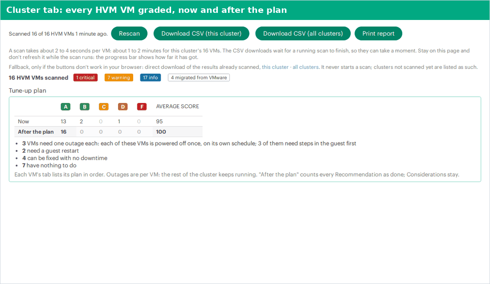

<sub>A short tour: the cluster tab (every HVM VM in the cluster, graded, grouped by origin and ordered by tune-up benefit), live migration readiness, one VM's tune-up plan, the guest checks and the printable report. Names and addresses in every screenshot are example values (`cluster-a`, `hvm-host-01`, `app-legacy-01`), the same ones the [install guide](docs/INSTALL.md) uses.</sub>

## No credentials: what each VM and host needs instead

**VM Tune-Up never needs credentials.** There is nothing to enter: no Morpheus API key, no guest password, no SSH key, no WinRM login, no host account, not per user and not per VM. The plugin has no settings form, and it never asks for, receives or stores a secret. Everything goes through channels Morpheus already has.

| What the plugin reads or runs | How it gets there | Credentials | What must be in place instead |
|---|---|---|---|
| Morpheus data (all Tier 1 checks, the plan, CSV, report) | The plugin API, as the signed-in user | None: your Morpheus sign-in | The **VM Tune-Up: View results** permission on the user's role |
| Windows VMs (guest agent check, guest checks) | Morpheus guest execution through the **QEMU guest agent** | None | The QEMU guest agent installed and running in the VM (from the VirtIO guest tools), the VM managed by Morpheus and powered on |
| Linux VMs (guest checks) | Morpheus guest execution through the **Morpheus agent** | None | The Morpheus agent installed and connected, the VM managed by Morpheus and powered on |
| HVM hosts (host CPU check) | Morpheus's own connection to its hosts | None | Nothing extra: every HVM host is already managed by Morpheus |
| The one write (fill in OS fields) | The plugin API, as the signed-in user | None | The **VM Tune-Up: Update VM records** permission |

**Per user, the only thing to set is permissions** (see [Permissions](#permissions)). Each guest or host command runs because a signed-in user with **VM Tune-Up: Run guest and host checks** asked for it, and the Morpheus log records that user's id.

**Per VM, the only thing to have is a working agent**, not a credential. A VM without one simply shows those checks as unknown. If you install the Morpheus agent on a Linux VM (Instance > Actions > Install Agent), Morpheus may connect to the VM over SSH or WinRM with the login it already holds for that VM, set when the VM was provisioned or converted to managed. That is Morpheus's own agent install, done once, outside VM Tune-Up; see HPE's [Agent install methods](https://docs.morpheusdata.com/en/9.1/getting_started/functionality/agent/installMethods.html) ([source on GitHub](https://github.com/HewlettPackard/morpheus-docs)).

## Why you'll want it

- **Migration is the start, not the finish.** A VM that boots on HVM can still run on emulated disks and network adapters, the Legacy chipset and no guest agent, and carry VMware Tools, snapshots and ISOs from the move. VM Tune-Up finds all of it in minutes, across the whole cluster.
- **A plan, not just a list.** Each VM's fixes are grouped by the downtime they need: things you can do any time, one guest restart, and **one outage of the VM**, where Morpheus powers it off once for every hardware change. Outages are per VM: the rest of the cluster keeps running. What must happen first (drivers, backups) is listed once, in order. You see the grade **now** and **after the plan**, per VM and for the cluster.
- **Works whatever tool you used.** Morpheus's own migration tool, an image upload, a third-party converter or a VM that was simply discovered on the hosts: the checks look at the VM as it is today. Each VM is also put in an origin group (**Migrated**, **Not migrated**, **Origin unknown**), with honest wording about what Morpheus data can and can't show.
- **Every finding is a plan, not a scare.** "If you leave it" says what the problem costs you. "If you fix it" gives the downtime, the risk, whether it can be undone, and what must happen first, in order. HPE documentation is cited first.
- **Recommendations you can actually do.** A **Recommendation** is something you can do in the Morpheus UI or inside the guest OS. Anything that would need host-level work is a **Consideration**: worth knowing, never recommended.
- **Optional checks inside the guest and on the hosts.** For people you trust with it, one fixed, read-only script per OS looks inside the VM (VirtIO readiness, VMware Tools leftovers, guest agent, time sync), and a host CPU check reads each HVM host's CPU models with `virsh`. Both run only when someone with the permission clicks a button.
- **No credentials, ever.** You never type a password, key or token into the plugin, and it stores none. Everything goes through channels Morpheus already has: its own data, its guest execution, and its own connection to the HVM hosts.
- **Read-only, except one opt-in action.** The checks change nothing. The one write is **Fill in OS fields**: it fills a VM's **empty** guest OS fields in Morpheus from what the guest scan found, only after you confirm, only for people with its own permission, and every write is logged. Nothing leaves the appliance: no external calls, no telemetry.
- **Works on every license.** The cluster tab, the CSV export and the printable report are the fleet view, so it works on the Morpheus VM Essentials license, which has no Reports page. Where your license includes Reports, there's a fleet report too.
- **One and done.** Install it, scan, plan your fixes, uninstall it. No schedules, no agents to install, nothing to configure.
- **Doesn't slow Morpheus down.** Tabs never block a page load. Scans run in the background, only when someone opens a tab, and pace themselves.

## Get started

1. Download `vm-tuneup-morpheus-plugin-<version>.jar` and `SHA256SUMS` from the [releases](../../releases), and check the jar.
2. In Morpheus, upload the jar: **Administration → Integrations → Plugins → Add**.
3. Give the people who'll use it the **VM Tune-Up: View results** permission (a ready-made role script is included). The two other permissions are optional.
4. Open an HVM cluster: **Infrastructure → Clusters → (cluster) → VM Tune-Up**. Wait for the scan, then open any VM's tab, download the CSV or print the report.

Step-by-step instructions, written for someone doing this for the first time: **[docs/INSTALL.md](docs/INSTALL.md)**. How the pieces fit together: **[How it works](#how-it-works)**.

## Tour

### The cluster tab: your fleet view

Open an HVM cluster and choose the **VM Tune-Up** tab (Morpheus may put it under the tab row's overflow menu). The first time, the tab scans the cluster in the background and shows its progress ("Scanned 4 of 9 HVM VMs"). A scan takes about 2 to 4 seconds per VM, so about 1 to 2 minutes for 16 VMs. Stay on the page and don't refresh it while the scan runs: the progress bar shows how far it has got. A small activity indicator shows whenever something is running. Then it shows:

- **Grade counts** (A to F) and **findings by severity** (critical, warning, info) for the whole cluster;
- **Tune-up plan:** a table of grade counts and the average score **Now** and **After the plan**, and how many VMs need one outage each (each of those VMs is powered off once, on its own schedule), a guest restart, no downtime, or nothing at all;
- **Live migration readiness:** the [host CPU check](#the-host-cpu-check) (master-tenant users with the guest-scan permission);
- **Guest checks:** **Run guest checks on all powered-on VMs**, and the VMs with empty OS fields in Morpheus that can be filled in from what the guest checks read inside the guest (see [Guest checks](#guest-checks-tier-2) and [Fill in OS fields](#fill-in-os-fields-the-one-write));
- **By origin:** the same counts per origin group;
- **VMs ordered by tune-up benefit:** the VMs whose plan gains the most points come first, then the lowest score, then the name. Each row has the grade, score, the grade after the plan, the plan's downtime, top findings, and a link to the VM in Morpheus. Tick **Migrated VMs only** to see just those, and see the top 15 or **Show all**;
- **Findings per check:** how many VMs fail each check, and how many couldn't be decided;
- buttons: **Rescan**, **Download CSV (this cluster)**, **Download CSV (all clusters)** and **Print report**. The grey line under the CSV buttons gives a rough scan time for the cluster's VM count.

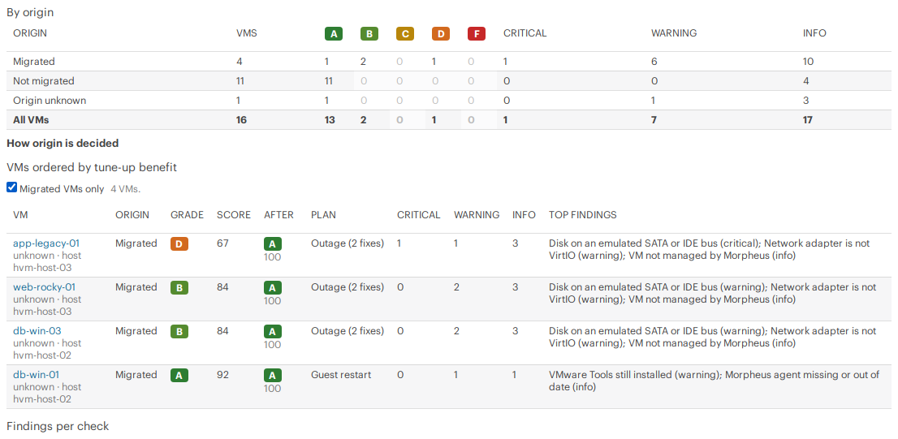

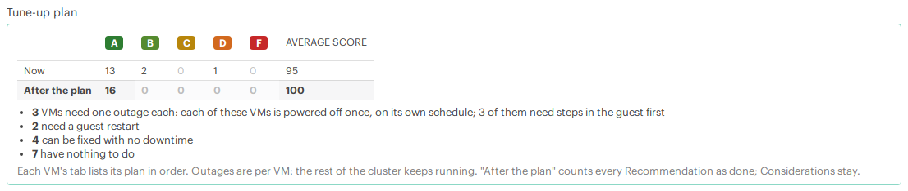

### The VM tab: what to fix, and how

Every HVM VM (and every instance on one) gets a **VM Tune-Up** tab with its grade, its tune-up plan and its findings, worst first. Discovered VMs, which have no instance, get it on the VM page.

The **tune-up plan** comes first. It shows the downtime the VM needs ("One outage of this VM (powered off once) for 2 fixes", "One guest restart", "No downtime" or "Nothing to do"), the grade now and after the plan, and a link to the instance (or VM) in Morpheus, where the actions are. Then, in order:

- **Before the outage, in this order:** the prerequisites of every fix in the outage, once each, only those for the VM's OS;
- **Any time, no downtime:** fixes you can do while the VM runs;
- **With one guest restart:** fixes that restart the guest OS;
- **During one outage of this VM (Morpheus powers it off once), in this order:** fixes where Morpheus powers the VM off and changes its hardware.

"After the plan" counts every Recommendation as done. Considerations aren't part of the plan and keep their score; the plan only mentions how many there are.

Below the plan, each finding shows:

- the **evidence** (what the plugin read, for example each disk's bus and controller);
- **If you leave it:** what the problem costs you;
- **If you fix it:** the downtime, the risk, whether it can be undone, and **Do first, in this order:** the prerequisites;
- **How in Morpheus:** where to do it (for example *Actions → Reconfigure → Advanced Options*);
- whether it's a **Recommendation** or a **Consideration**, anything **not yet verified**, and references.

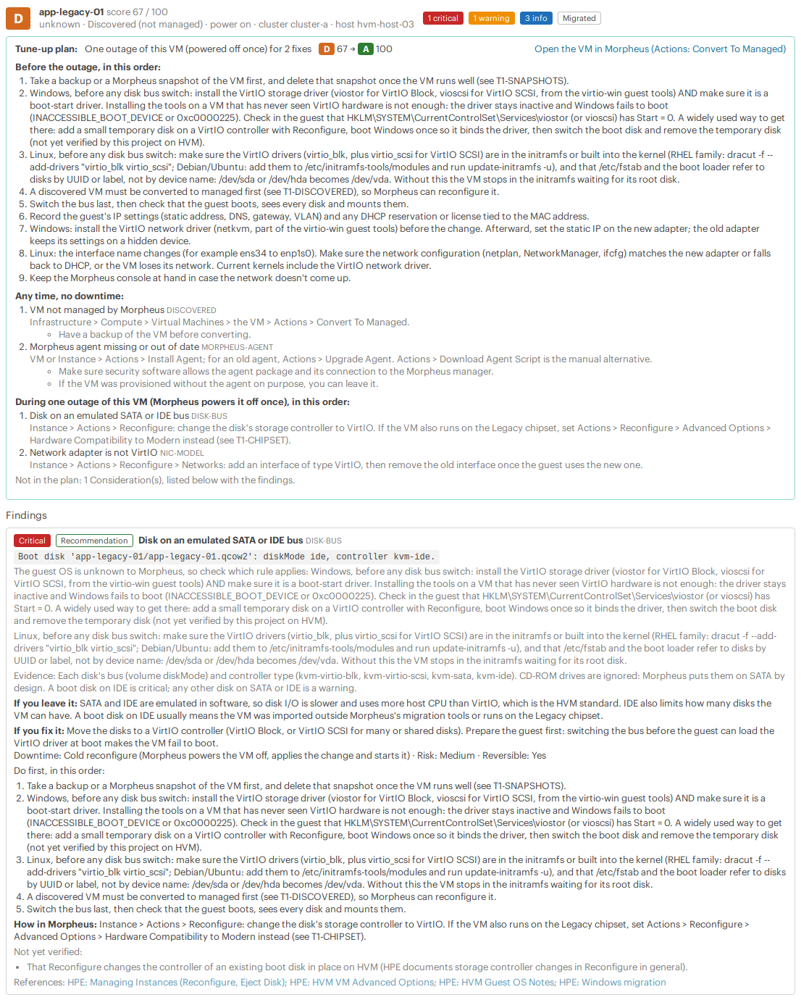

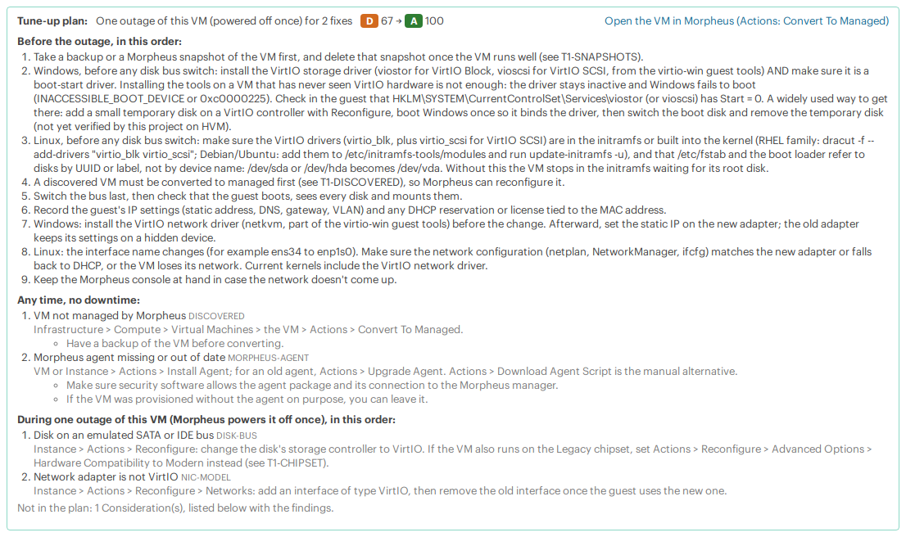

Checks the plugin couldn't decide for this VM (for example on Morpheus 9.0.x, which doesn't report the chipset) are listed separately as **Unknown or not evaluated**. They cost no points and never count as a pass.

At the top of the tab is a row per action: the button on the left (all the same width), its status to the right, and the detail underneath:

- **Refresh**: "Scanned 2 min ago."
- **Check guest agent**: the last answer ("Answered 2 min ago").
- **Run guest checks**: "Guest checked 5 min ago: <OS>."
- **Fill in OS fields** (when there is something to fill in): "Morpheus has no OS type, OS family, platform for this VM. The guest reports <OS>." Underneath, it explains that this copies what the guest checks read from inside the VM (through its agent) into the empty OS fields of this VM's Morpheus record, and that fields Morpheus already has stay as they are.

Users without the right permissions see what each action does, greyed out, with the permission it needs.

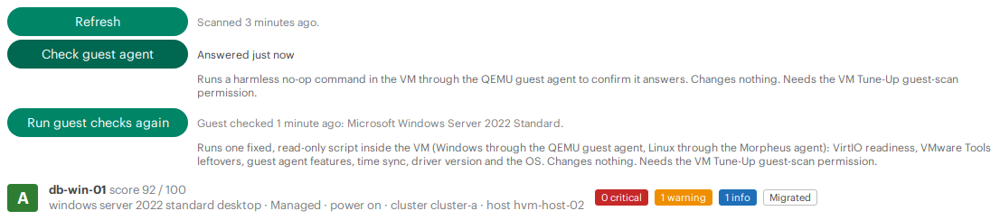

### CSV export

**Download CSV (this cluster)** and **Download CSV (all clusters)** save one row per VM, lowest score first, with the plan's columns, ready for a spreadsheet and a change plan. A download waits for a running scan to finish, so it can take a moment; stay on the page and don't refresh it. See [CSV columns](#csv-columns).

### Printable report

**Print report** on the cluster tab opens the cluster's report as a clean page: a summary (VMs scanned, average score now and after the plan, how many VMs need one outage each, a guest restart or no downtime), the VMs ordered by tune-up benefit with their grade now and after, the tune-up plan of each VM that has one, and the live migration readiness (host CPU) result if one was run. Use your browser's **Print** and choose **Save as PDF** to keep it or send it. The report uses only results already scanned: it never starts a scan or runs a command, and it says "Not ready yet" while the cluster is still scanning.

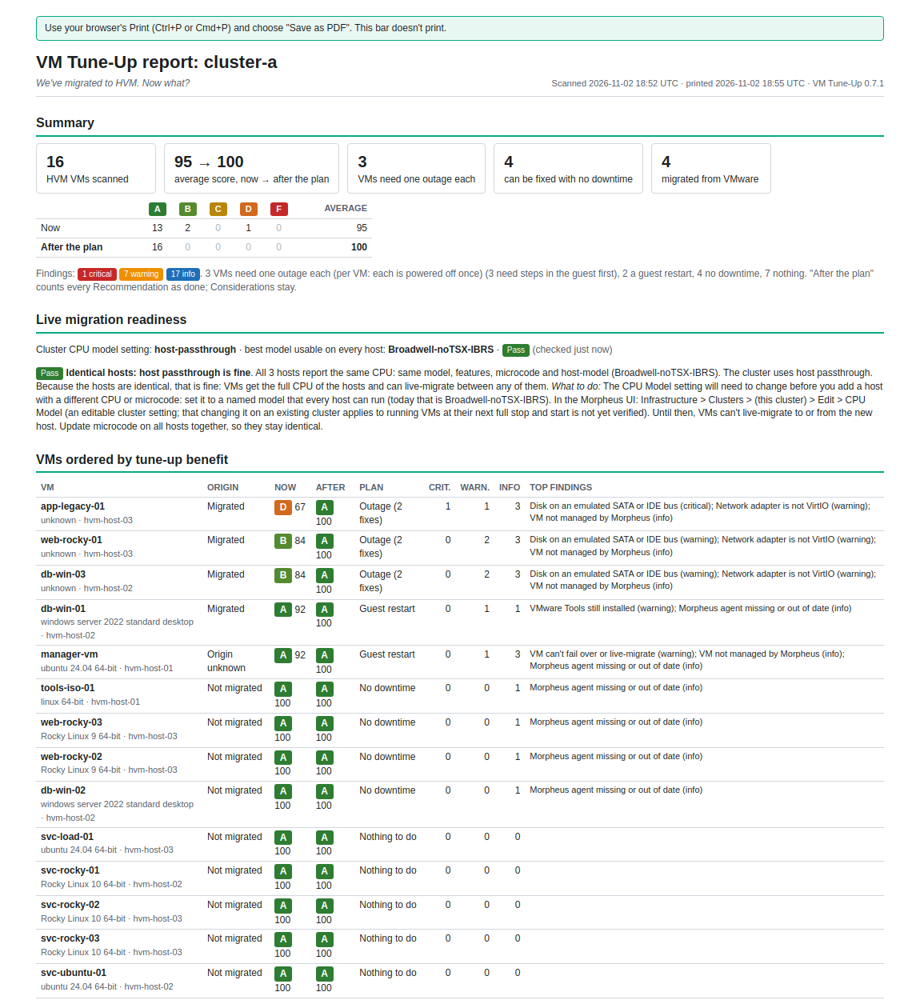

## The checks

There are three kinds of check:

- **Tier 1** (`T1-`): 16 checks from Morpheus data only. They run for every VM, every scan.
- **Tier 2** (`T2-`): 6 checks from inside the guest. They run only after a [guest scan](#guest-checks-tier-2), which someone with the guest-scan permission starts.
- **The host CPU check:** one check per cluster, on the HVM hosts. It isn't part of the VM grades. See [The host CPU check](#the-host-cpu-check).

The UI shows each check by its title, with a short ID in small type (for example `DISK-BUS`). In the plugin's code and logs, the IDs carry the tier prefix.

### Tier 1: Morpheus data

Listed in fix-plan order: what to do first comes first.

| Check | Severity | Type | If you fix it: downtime, risk, can be undone | Unknown when |
|---|---|---|---|---|
| VM not managed by Morpheus (`DISCOVERED`) | info | Recommendation | none; low; yes | |
| Old or many snapshots (`SNAPSHOTS`) | info; warning when older than 90 days | Recommendation | none; medium; **no** | snapshots can't be read |
| ISO still attached (`ISO-ATTACHED`) | info | Recommendation | none; low; yes | |
| VM can't fail over or live-migrate (`HA-MOBILITY`) | warning for disks on host-local storage; info for pinned placement or passthrough devices | Recommendation | none (Move runs live); medium; yes | a disk's datastore can't be read |
| QEMU guest agent not connected (`GA-STATUS`) | warning | Recommendation | none; low; yes | VM powered off or power state unknown; status not reported and not checked |
| QEMU guest agent channel disabled (`GA-CHANNEL`) | warning | Consideration | cold reconfigure; low; yes | Morpheus 9.0.x; discovered VMs |
| Morpheus agent missing or out of date (`MORPHEUS-AGENT`) | info; warning when silent for over 7 days | Recommendation | none; low; yes | until the fleet's newest agent version is known |
| OS type fields incomplete after migration (`OS-TYPE-MISMATCH`) | info; warning for Windows | Consideration | none; low; yes | |
| Nested virtualization turned on (`NESTED-VIRT`) | warning | Recommendation | cold reconfigure; low; yes | discovered VMs |
| vCPUs spread over too many sockets (`CPU-TOPOLOGY`), Windows only | **critical** for Windows 10 or 11 with more than 2 sockets; info (2 points) for other Windows with more than 1 socket | Recommendation | cold reconfigure; low; yes | vCPUs or cores per socket not reported |
| Disk on an emulated SATA or IDE bus (`DISK-BUS`) | warning; critical for a boot disk on IDE | Recommendation | cold reconfigure; medium; yes | Morpheus lists no disks |
| Network adapter is not VirtIO (`NIC-MODEL`) | warning | Recommendation | cold reconfigure; medium; yes | |
| Legacy (i440fx) chipset (`CHIPSET`) | warning | Recommendation | cold reconfigure; high; yes | Morpheus 9.0.x; discovered VMs |
| Firmware or TPM doesn't fit the OS (`FIRMWARE`) | info | Recommendation | cold reconfigure; high; **no** | the guest OS is unknown |
| VMware MAC address kept (`VMWARE-MAC`) | info | Consideration | none; low; yes | |
| Disk possibly fully allocated (thick) (`DISK-ALLOCATION`) | info | Recommendation | none; low; yes | no used size reported |

"Cold reconfigure" means Morpheus powers the VM off, applies the change and starts it again. The snapshot and allocation thresholds are the plugin's own heuristics, not HPE guidance, and each finding says so.

**A few things worth knowing:**

- **Disk bus and chipset fixes list their prerequisites in order.** On Windows, the VirtIO storage driver must be installed **and** a boot-start driver before the switch, or Windows fails to boot. On Linux, VirtIO must be in the initramfs (or built into the kernel), and `/etc/fstab` and the boot loader must refer to disks by UUID or label. The plan lists each step once, before the outage. The guest checks can confirm the guest is ready (`VIRTIO-READY`).
- **Network adapter changes** give the guest a new adapter: record its IP settings first, and keep the Morpheus console at hand.
- **Network adapters Morpheus doesn't name** (it reports E1000E and some other models with no type) count as "not VirtIO, model unknown".
- **HA and mobility.** A VM with a disk on a host's local (directory) datastore stays down when that host does. NFS and HPE clustered datastores are shared. The fix is **Actions → Move** to shared storage, which runs live when the VM is on.
- **Nested virtualization** marks a VM as not migratable on HVM, so host maintenance means downtime for it. Turn it off unless the guest really runs Hyper-V, WSL 2, nested KVM or similar.
- **CPU topology.** HVM creates VMs with one core per socket, so a 4-vCPU VM shows the guest 4 sockets of 1 core. Windows 10 and 11 use at most 2 sockets, so such a VM runs on 2 vCPUs and wastes the rest: that's critical. HPE recommends cores per socket equal to the vCPU count for Windows.
- **The VMware MAC check is a Consideration.** Keeping the MAC is usually harmless; the real risk is the VMware source VM being powered on again on the same network.

### Tier 2: inside the guest

These checks appear only after a guest scan of the VM (see [Guest checks](#guest-checks-tier-2)). Until then they don't show and cost nothing.

| Check | Severity | Type | If you fix it: downtime, risk, can be undone |
|---|---|---|---|
| Guest not ready for the switch to VirtIO (`VIRTIO-READY`) | warning while a disk is still on SATA or IDE; info otherwise | Recommendation | cold reconfigure (the bus switch itself); medium; yes |
| VMware Tools still installed (`VMWARE-TOOLS`) | warning when its service still starts; info for idle leftovers | Recommendation | guest restart; low; yes |
| Guest agent can't freeze the file systems (`GA-FEATURES`) | warning | Recommendation | none; low; yes |
| Guest time not synchronized (`TIME-SYNC`) | warning (info for a Linux clock source other than kvm-clock) | Recommendation | none; low; yes |
| VirtIO driver version (`VIRTIO-VERSION`), Windows only | info, when older than the newest in the cluster | Recommendation | guest restart; medium; yes |
| Domain controller without VM-Generation ID (`DC-VMGENID`), Windows only | warning; critical when the domain controller has Morpheus snapshots | Consideration | none; low; yes |

A guest scan that failed, or a value the script couldn't read, makes the check **unknown**, never a pass.

### What "unknown" means

A check is **unknown** when the data it needs isn't there, and the VM tab says why. The common cases:

- **Morpheus 9.0.x** doesn't report the chipset (machine type) or the guest agent channel, so `CHIPSET` and `GA-CHANNEL` are unknown on 9.0.x.
- **Discovered (unmanaged) VMs** have no Morpheus configuration, so `CHIPSET`, `GA-CHANNEL` and `NESTED-VIRT` are unknown for them.
- **Powered-off VMs:** the guest agent status is judged only while the VM runs.
- **Time budget:** a part of a scan that didn't finish in time (snapshots, host or cluster name) shows as "unknown: time budget", and the rest of the result is still shown.

Unknown checks cost no points and are listed separately. They never count as a pass.

### Origin groups

Each VM is put in one of three groups, on the cluster tab and in the CSV (`origin`):

| Group | When | What it can't tell you |
|---|---|---|
| **Migrated** | The VM still has a VMware MAC address (prefix 00:50:56, 00:0C:29, 00:05:69 or 00:1C:14), or its OS type fields are incomplete the way a native VMware migration leaves them, or (after the guest checks) VMware Tools was found inside a Windows guest (`VMWARE-TOOLS` fails). | |
| **Not migrated** | A managed VM with none of these signs. | Most are VMs built on HVM, but a VM moved by an image upload or another tool, with a new MAC address and corrected OS fields, also lands here until the guest checks find VMware Tools. |
| **Origin unknown** | A discovered (unmanaged) VM with none of these signs. | It may have been created outside Morpheus or moved by another tool. |

VMware Tools counts only on Windows: many Linux images ship open-vm-tools by default, so on Linux it says nothing about where the VM came from. Hover over a VM's origin on the cluster tab to see why it's in that group, for example "VMware MAC address", "OS fields left incomplete by a VMware migration", "VMware Tools in the guest", or "managed VM: no VMware MAC, OS fields complete, guest checks not run". The cluster tab explains all this under **How origin is decided**, and its summary badge counts the VMs as "N migrated from VMware".

### Scoring and the plan

Each VM starts at 100. Each failed check costs points: critical 25, warning 8, info 0 to 2. The score never goes below 0. Grades: **A** 90+, **B** 80+, **C** 70+, **D** 60+, **F** below 60. Unknown and not-evaluated checks cost nothing.

The **score after the plan** is the same calculation with every failed Recommendation counted as fixed. Considerations and unknown checks stay as they are. The plan's downtime is the biggest interruption any of its fixes needs: one outage of the VM if any fix needs Morpheus to power it off, else a guest restart, else no downtime.

## The guest agent check

Through the plugin API, Morpheus 9.1.0.1 reports every VM's QEMU guest agent status as "unknown". So for the guest agent check (`GA-STATUS`), when a powered-on HVM VM's status is unknown, the plugin can ask the guest to run one fixed, harmless no-op command: `true` on Linux, `cmd /c exit 0` on Windows. It goes through Morpheus's own guest execution, not SSH or WinRM, with no credentials. Only the success flag, the exit code and the first 200 characters of an error message are kept; never any output.

- **Who, and when:** only users whose role has **VM Tune-Up: Run guest and host checks** at **Full**, and never automatically when a tab opens. On the VM tab, they get **Check guest agent**, with a one-line explanation and the last result and its time ("Answered 2 min ago", "No answer 5 min ago: <short error>"). A cluster scan started by such a user (opening the cluster tab, or **Rescan**) also checks each powered-on VM of their own tenant in the background, and so does the fleet report they run.
- **Windows:** Morpheus runs the command through the QEMU guest agent. An answer passes the check; no answer fails it.
- **Linux:** Morpheus runs guest commands through its own Morpheus agent, so the check tests that agent, not the QEMU guest agent. The VM tab says so next to the button. An answer passes; no answer leaves the check **unknown**, not failed.
- **Never checked:** powered-off VMs, servers that aren't HVM VMs, and VMs whose status Morpheus does report (then no button appears).
- **Limits:** 20 seconds per VM; at most once a minute per VM (sooner, the last result is shown); one at a time per VM. The fleet report checks at most 4 VMs at a time and starts none after 3 minutes ("not probed: time budget").
- **Logged:** each run is logged on the appliance with the Morpheus user id and server id. Results are kept in memory for 10 minutes and shown only to users with the guest-scan permission.

## Guest checks (Tier 2)

Some things can only be seen from inside the guest: whether the VirtIO drivers are ready before a bus switch, whether VMware Tools still runs, whether the guest agent can freeze the file systems for a consistent snapshot, whether the clock is synchronized. **Run guest checks** looks for them.

- **Who, and when:** users with **VM Tune-Up: Run guest and host checks** at **Full**, only when they click. On the VM tab: **Run guest checks** (one VM). On the cluster tab: **Run guest checks on all powered-on VMs** (every powered-on HVM VM of the cluster their tenant can see, one VM at a time, with progress). Never automatically.
- **What runs:** one fixed, read-only script per OS, built into the plugin. Nothing from the page, the user or the VM is ever put into it. It runs once per VM. The checks only read; nothing in the VM changes.
  - **Windows:** a PowerShell script (Windows PowerShell 4.0 or later), run as SYSTEM through the **QEMU guest agent**, by Morpheus's guest execution;
  - **Linux:** a POSIX `sh` script, run as root through the **Morpheus agent**, by Morpheus's guest execution.
- **No credentials.** The plugin never asks for or holds a guest password, SSH key or WinRM login. Morpheus uses the channel it already has to each VM.
- **What it changes:** nothing. It writes no file, changes no setting, installs nothing and opens no network connection. (On dracut systems, `lsinitrd` makes and removes an empty temporary directory of its own.)
- **What comes back:** a short `key=value` list, each value cut to 200 characters, at most 150 lines. The output is never written to the log: only the user id, the server id and the script's SHA-256 are logged, so you can tell which script ran.
- **Limits:** 2 minutes per VM (1 minute inside a cluster run), one run per VM at a time, at most once a minute per VM. A cluster run checks at most 200 VMs, skips VMs with a result less than an hour old, and stops starting new VMs after 90 minutes; it runs on its own worker, so single-VM runs never wait for it. Guest details (kernel, fstab devices, time source) are shown only to users who may run guest checks; view-only users see the grades without them. A scan runs in the background; the tab shows "Running the guest checks inside the VM (this can take a few minutes)…" and refreshes itself.
- **Results** are kept in memory for **1 hour**. While they're there, the Tier 2 checks are part of the VM's grade and plan, for everyone who can view the VM, and feed [Fill in OS fields](#fill-in-os-fields-the-one-write).

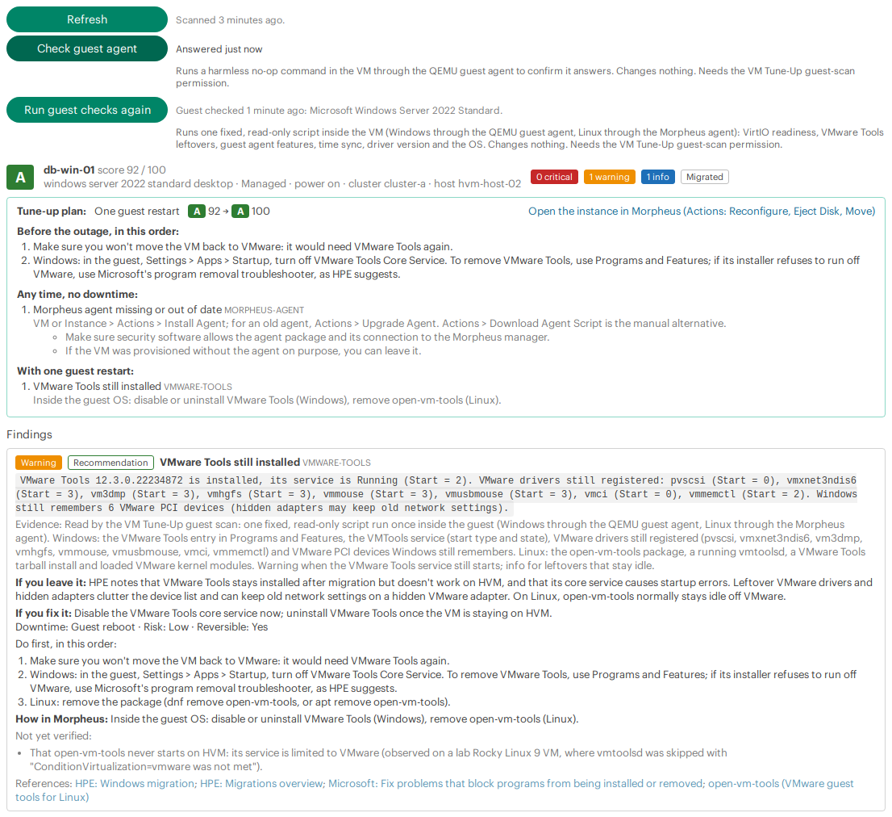

### What the Windows script reads

- `Get-CimInstance Win32_OperatingSystem`: Caption, BuildNumber, ProductType (1 workstation, 2 domain controller, 3 server), OSArchitecture.
- `Get-CimInstance Win32_ComputerSystem`: DomainRole (4 backup domain controller, 5 primary domain controller).
- Registry `HKLM\SOFTWARE\Microsoft\Windows NT\CurrentVersion`: EditionID, InstallationType (Server, Server Core, Client), DisplayVersion.
- `whoami /user`: whether the scan runs as SYSTEM (S-1-5-18).
- Registry `HKLM\SYSTEM\CurrentControlSet\Services\<name>`: whether each service exists and its Start value (0 boot, 1 system, 2 automatic, 3 manual, 4 disabled), for viostor, vioscsi, netkvm, VirtioSerial, balloon, pvscsi, vmxnet3ndis6, vm3dmp, vmhgfs, vmmouse, vmusbmouse, vmci, vmmemctl, VMTools, VGAuthService, QEMU-GA, QEMU Guest Agent VSS Provider and W32Time; and the QEMU-GA ImagePath, for blocked or allowed guest agent commands.
- `Get-Service`: running state of VMTools, QEMU-GA, QEMU Guest Agent VSS Provider and W32Time.
- File version of `%SystemRoot%\System32\drivers\viostor.sys`, `vioscsi.sys` and `netkvm.sys`; whether viostor, vioscsi and netkvm are staged in the driver store (`DriverStore\FileRepository`).
- Registry Uninstall keys (64- and 32-bit): DisplayVersion of VMware Tools, the virtio-win guest tools and the QEMU guest agent.
- Registry `HKLM\SYSTEM\CurrentControlSet\Services\VSS\Providers`: names of the registered VSS providers (at most 10).
- Registry `HKLM\SYSTEM\CurrentControlSet\Enum\PCI`: how many VMware (vendor 15AD) PCI devices Windows still remembers.
- `w32tm /query /source` and the W32Time Parameters Type value: where Windows gets its time.

### What the Linux script reads

- `id -u`: whether the scan runs as root.
- `/etc/os-release`: ID, VERSION_ID, NAME, PRETTY_NAME, ID_LIKE (read with `sed`; the file is never sourced or run).
- `uname -r` and `uname -m`: running kernel and architecture.
- `/lib/modules/<kernel>/modules.builtin` and a `find` for the module files: whether virtio_blk, virtio_scsi, virtio_pci and virtio_net are built into the kernel or available as modules.
- The initramfs of the running kernel: on dracut systems (RHEL family, SUSE), `lsinitrd` lists `/boot/initramfs-<kernel>.img` (30-second limit); on Debian and Ubuntu, the MODULES setting in `/etc/initramfs-tools/initramfs.conf` and `conf.d`, and the modules listed in `/etc/initramfs-tools/modules`.
- `/etc/fstab`: entries that mount by device name or bus path (`/dev/sdX`, `/dev/hdX`, `/dev/xvdX`, `/dev/disk/by-path`, `/dev/disk/by-id/ata-`, `scsi-`, `wwn-`, `nvme-`), at most 20.
- `/proc/cmdline`: the `root=` and `resume=` values.
- `ps -e`: whether vmtoolsd, qemu-ga, chronyd, ntpd or systemd-timesyncd run; the qemu-ga command line, for allowed or blocked commands.
- `rpm -q` or `dpkg-query -W`: installed versions of open-vm-tools and qemu-guest-agent.
- `/etc/vmware-tools/locations` or `/usr/bin/vmware-uninstall-tools.pl`: a VMware Tools tarball install; `/proc/modules`: loaded VMware kernel modules.
- `/dev/virtio-ports/org.qemu.guest_agent.0`: the guest agent channel; `/etc/sysconfig/qemu-ga`, `/etc/default/qemu-guest-agent`, `/etc/qemu/qemu-ga.conf`: whether guest-fsfreeze-freeze and guest-exec are allowed; `/etc/qemu/fsfreeze-hook`.
- `/sys/devices/system/clocksource/clocksource0`: current and available clock sources; `timedatectl`: whether NTP has synchronized the clock.

The full scripts, with comments, are in [`core/GuestScripts.groovy`](src/main/groovy/io/github/grahamfairbank/vmtuneup/core/GuestScripts.groovy). Tests pin both scripts to their reviewed versions, check that no command is ever built from a parameter, that the Linux script writes nowhere, and that every command a script runs is in the lists above.

## Fill in OS fields: the one write

A migrated VM often has empty guest OS fields in Morpheus (OS type, OS family, platform, version). That hides it from OS-based reports and policies and makes some checks unknown. The guest checks read each VM's OS from inside the guest, through its agent. **Fill in** copies that OS into the empty OS fields of the VM's Morpheus record, so Morpheus shows the right OS. Nothing in the VM itself changes.

- **Who:** only users whose role has **VM Tune-Up: Update VM records** at **Full** (a separate permission; giving someone guest scans doesn't give them this).
- **Where:** on the VM tab, **Fill in OS fields**, next to "Morpheus has no OS type, OS family, platform for this VM. The guest reports <OS>." On the cluster tab, under **Guest checks**, the **Missing OS fields** list: the VMs that would be filled in and what each would get, and **Fill in N VMs in Morpheus**.
- **Confirm first:** the browser asks before anything is written: "Copy the OS the guest reported (<OS>) into the empty OS fields of this VM's Morpheus record? …" on the VM tab, and "Copy the OS each guest reported into the empty OS fields of these N VMs' Morpheus records? …" on the cluster tab.
- **Only empty fields.** A field Morpheus already has is never changed. The OS must have a confident match in Morpheus's own OS type catalog; if not, nothing is written and the tab says to set it by hand.
- **One save per VM**, through Morpheus's plugin API, on a fresh copy of the VM record.
- **Logged:** each write is logged on the appliance with the Morpheus user id, the server id and the OS code.
- **Undo:** edit the VM in Morpheus and set the fields back. Nothing else is touched.

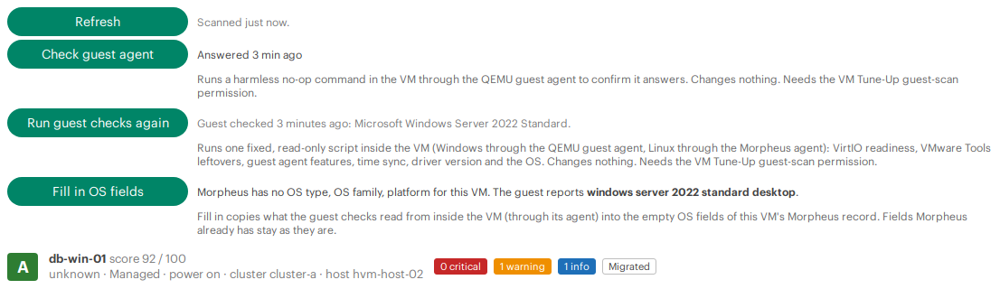

## The host CPU check

Live migration between HVM hosts needs every host to offer the CPU the VM was started with. The cluster's CPU model setting decides that. Host passthrough (HVM's default) is fine only while every host has the same CPU **and** microcode; microcode updates have removed CPU features before (Intel TSX), so a named model that worked last month may not work after a patch. The host CPU check looks at what each host can really run today.

- **Who, and when:** users in the **master tenant** whose role has **VM Tune-Up: Run guest and host checks** at **Full**, only when they click **Check the hosts** (later **Check again**) in the cluster tab's **Live migration readiness** section. The result is shown only to master-tenant users.
- **What runs:** on each HVM host of the cluster, through Morpheus's own connection to the host, two fixed, read-only commands:
  - `virsh -c qemu:///system capabilities` (the host's CPU model, vendor, features and microcode);
  - `virsh -c qemu:///system domcapabilities --virttype kvm` (which named CPU models this host can run, and what blocks the others).

  `domcapabilities` needs a read-write libvirt connection, so each runs as root, or through `sudo -n` (which never prompts) when Morpheus's host account isn't root. No credentials are entered: Morpheus uses the access it already has to its hosts.
- **What it checks:** the cluster's CPU model setting against every host: CPU vendors or architectures that differ (critical); host passthrough or host-model on hosts that differ (warning); a named model that some host can't run, with libvirt's reason, for example TSX removed by microcode (critical); a deprecated or newer-than-needed model; and hosts that couldn't be read (unknown, never a pass).
- **What it recommends:** the newest named CPU model that **every** host can run today, and where to change it in Morpheus (**Infrastructure → Clusters → (cluster) → Edit**). It also says what to watch: keep hosts identical while you use host passthrough, and update microcode on all hosts together. When the hosts are identical, the result is **Identical hosts: host passthrough is fine** (or host-model or maximum, by the setting): VMs get the full host CPU and can live-migrate between the hosts. Its **What to do** says that before you add a host with a different CPU or microcode, the CPU Model setting must change to a named model every host can run, and names the best one (for example, "today that is Broadwell-noTSX-IBRS"); until then, VMs can't live-migrate to or from the new host.
- **Limits:** 90 seconds per command per host; one run per cluster at a time; the result is kept for **1 hour**. Output is capped and parsed with a hardened XML parser. Each run is logged with the user id and cluster id.
- **Not part of the VM grades.** It's a cluster-level result, on the cluster tab and in the printable report.

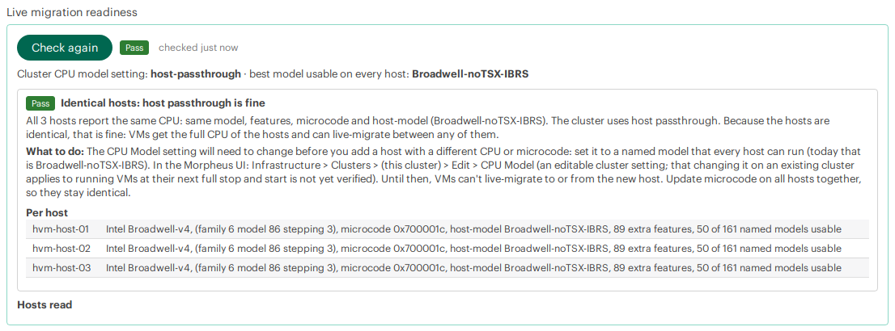

## Where users see it

| Where | What | License |
|---|---|---|
| **Cluster tab** (Infrastructure → Clusters → an HVM cluster → VM Tune-Up) | The fleet view: grade counts now and after the plan, findings by severity, live migration readiness, guest checks, origin groups, VMs ordered by tune-up benefit, findings per check, Rescan, CSV downloads and Print report. | Every license |
| **VM tab** (Infrastructure → Compute → Virtual Machines → a VM) and **instance tab** (Provisioning → Instances → an instance) | One VM's grade, tune-up plan and findings, with Refresh, Check guest agent, Run guest checks and Fill in OS fields. | Every license |
| **CSV export** (from the cluster tab) | One row per VM, for this cluster or every HVM cluster you can see. | Every license |
| **Printable report** (from the cluster tab) | A page for your browser's Save as PDF: summary, VMs ordered by tune-up benefit, plan per VM, live migration readiness. | Every license |
| **Fleet report** (Operations → Reports → VM Tune-Up) | A summary, then **VMs by score (lowest first)**, one row per HVM VM with a **Migrated** column; Morpheus can export the rows as CSV. Runs from the master tenant only, for users with the view permission. | Licenses that include Reports |

The Reports page isn't part of the Morpheus VM Essentials license, so on that edition the cluster tab, the CSV and the printable report are the fleet view.

### CSV columns

`name`, `cluster`, `host`, `os`, `serverType`, `managed`, `power`, `grade`, `score`, `gradeAfter`, `scoreAfter`, `planWindow`, `planSteps`, `critical`, `warning`, `info`, `unknown`, `vmwareOrigin` (yes/no), `origin` (migrated, not-migrated, unknown), `guestAgentProbe`, `topFindings` (plain titles with severity), `checkIds` (short IDs), `scanStatus`, `scannedAt`.

- `gradeAfter` and `scoreAfter`: the grade and score after the plan.
- `planWindow`: `cold` (one outage of the VM), `guest-reboot` (one guest restart), `live` (no downtime) or `none` (nothing to do).
- `planSteps`: the plan's checks in the order to do them, by short ID, for example `DISCOVERED > MORPHEUS-AGENT > DISK-BUS > NIC-MODEL`.

The browser builds the file from the plugin's own data: it shows progress ("Preparing CSV: scanned 12 of 63…"), waits for the scan to finish (about 2 to 4 seconds per VM; at most 15 minutes per cluster, after that the file has the VMs scanned so far, with a note). Stay on the page and don't refresh it while it runs. It saves `vm-tuneup-<cluster>-<date>.csv` in UTF-8 with a byte order mark, so Excel reads it correctly. **All clusters** goes through your clusters one at a time and saves one file. Cells a spreadsheet could read as a formula get a leading apostrophe.

Under the buttons, **direct download** links are a fallback for browsers where the buttons don't work. They give the same columns from results already in memory and never start a scan: a cluster that's still scanning, or wasn't scanned in the last 10 minutes, is listed as such.

## Performance

Tabs never block a page load. Morpheus renders plugin tabs while it builds the page, so the tabs only render a small "Loading…" shell, or a result already in memory. The plugin's script then fills the tab from the plugin's own routes, and only for a tab you actually open.

- **VM tab:** one VM is scanned with a 15-second budget.
- **Cluster tab:** the scan runs in the background, one per cluster at a time (a second viewer joins the running scan), on one worker that pauses 250 ms after each VM, with a 15-second budget per VM and 15 minutes overall. The tab shows progress and refreshes every 5 seconds until the scan is done; polling pauses while the tab is hidden.
- **Guest checks and the host CPU check** run on their own small worker pools, in the background, and the tab polls until they're done. A cluster's guest checks run one VM at a time, with a pause after each.
- **Agent baseline** (the newest Morpheus agent per OS family, for `MORPHEUS-AGENT`): computed in the background at most every 15 minutes.
- **Caching:** scan results are kept in memory for 10 minutes, so reopening a tab within that time is instant. Guest check and host CPU results are kept for 1 hour.
- **Limits:** at most 2 cluster scans run at once and 8 wait; beyond that, or beyond 3 running scans per user, a new scan is refused with "too many scans in progress, try again shortly".

All plugin threads are named `vm-tuneup-*` and stop when the plugin is disabled or removed.

## Permissions

The plugin adds three permissions to every Morpheus role. All start at **None**.

| Permission | Levels | Grants |
|---|---|---|
| **VM Tune-Up: View results** (`vm-tuneup-view`) | None, Read | The tabs and results, the tune-up plans, Rescan, the CSV downloads, the printable report and the fleet report. Users see only the VMs and clusters their tenant owns (the master tenant sees all). |
| **VM Tune-Up: Run guest and host checks** (`vm-tuneup-guest-scan`) | None, Full | Optional. Running read-only commands through Morpheus: the [guest agent check](#the-guest-agent-check) (a no-op), the [guest checks](#guest-checks-tier-2) (one fixed read-only script per OS), and, for master-tenant users, the [host CPU check](#the-host-cpu-check) (two read-only `virsh` commands on each host). Give it only to people you'd let run commands in those VMs and on those hosts. |
| **VM Tune-Up: Update VM records** (`vm-tuneup-update-records`) | None, Full | Optional. [Fill in OS fields](#fill-in-os-fields-the-one-write): the plugin's only write, to empty guest OS fields of VMs their tenant owns. Give it to people who may edit those VMs in Morpheus. |

Set them in **Administration → Roles → (role)**: search the permissions for "VM Tune-Up". Or run [`tools/create-readonly-user.py`](tools/create-readonly-user.py), which makes a least-privilege, read-only role and user for you (see the [install guide](docs/INSTALL.md#4-give-people-access)); it never grants **Update VM records**.

Viewing a stored fleet report is governed by Morpheus's own Reports permission, like any other report.

## Security

To report a vulnerability, see [SECURITY.md](SECURITY.md).

- **What runs where.** Everything runs inside the Morpheus appliance, in the plugin's own threads, through Morpheus's plugin API. The browser script only talks to the plugin's own routes on the same appliance. **Nothing is sent off the appliance**: no telemetry, no external calls.
- **No credentials, anywhere.** The plugin has no settings form and never asks for, receives or stores a password, key or token. Commands in guests go through Morpheus's guest execution (the QEMU guest agent on Windows, the Morpheus agent on Linux); commands on hosts go through Morpheus's own connection to its HVM hosts.
- **Read-only, except one opt-in action.** The checks read Morpheus data and never change a VM, host or cluster. Commands run only for users with **Run guest and host checks**, and are fixed constants: a no-op (guest agent check, also run during a cluster scan such a user starts), one read-only script per OS (guest checks, only on a click), and two read-only `virsh` queries per host (host CPU check, only on a click, master tenant only). Nothing from the request, the page or Morpheus data is ever put into a command. The only write is **Fill in OS fields**, behind **Update VM records**: empty OS fields only, after a confirm, logged.
- **Every route checks the user itself.** Morpheus only checks that a role has the permission code, so each route checks the level (view: Read; guest scans and host CPU: Full; OS fill-in: Full) and the tenant before it reads, scans or runs anything. Outside the master tenant, a user sees only their own tenant's VMs and clusters, a cluster-wide guest scan or fill-in covers only their tenant's VMs, and the host CPU check isn't available.
- **Only the plugin's own script starts work.** A GET starts or joins a scan only when it carries `X-Requested-With: XMLHttpRequest` and a same-origin `Origin`, `Referer` or `Sec-Fetch-Site`. A plain link, a new tab or another site gets results already in memory, or a note to open the tab; it never starts a scan or a command. Rescan, Check guest agent, Run guest checks, Check the hosts and Fill in OS fields are POSTs that also need the same origin and Morpheus's CSRF token. The only command a GET can lead to is the no-op guest agent check, inside a cluster scan started by a guest-scan user. `X-Forwarded-Host` isn't trusted for the origin check.
- **What's logged.** Each command run and each write is logged on the appliance with the Morpheus user id and the server or cluster id. Guest scan output is never logged (it can hold internal names); the script's SHA-256 is.
- **Output.** Every value is HTML-escaped in the tabs and the printable report. The script inserts only same-origin HTML that starts with the plugin's own markup (an expired session shows "Reload the page and sign in again" instead). CSV cells that could run as spreadsheet formulas are neutralized. The server CSV is served only as a `text/csv` attachment with `nosniff`, and JSON as UTF-8. Guest and host output is size-capped, and host XML is parsed with external entities and DTDs turned off.
- **What view users see (by design).** For the VMs their tenant owns, view users see what the checks are about: full MAC addresses, attached ISO and volume paths, host and cluster names, OS and agent versions, and, once someone has run the guest checks, what they found inside the guest (driver and service states, VMware Tools version, time source). A role without Infrastructure read still learns these through the plugin, so grant the view permission to people you'd show the VMs' settings to.
- **Status route.** `status` answers `ok` and the plugin version to view users, nothing else.
- **Tools.** `tools/create-readonly-user.py` creates a least-privilege role (the pages the tabs live on, plus the plugin's view permission; guest scans only with `--guest-scan`; never Update VM records), reads it back and stops if anything else is above None. `tools/collect-fleet-sample.py` (for contributors) collects an anonymized sample, with names, addresses, UUIDs and ids replaced by keyed tokens and dates coarsened, into a file only you can read.

### Independent security review

Before 0.4.0, the routes, permission model, browser script, tools, built jar and git history were reviewed independently by a separate AI reviewer (Anthropic's Claude Fable model), with read-only access to the source. It found **no Critical or High issue**, and nothing reachable without a Morpheus account. It found:

- **two Medium:** the server-side CSV fallback relied on a response header the appliance might drop; and a plain GET (for example a link) could start cluster scans, and with them the guest agent check for a user with the guest-scan permission;
- **several Low and Informational findings:** the VM route scanned before it checked the tenant; cluster views were scoped to the cluster's tenant rather than each VM's; the guest agent check had no rate limit; the scan queue had no bound; the CSV formula guard missed two cases; the role script granted more than the plugin needs; and documentation gaps about what view users can see.

All of them are fixed in 0.4.0, with tests. Every finding needed a signed-in Morpheus user with the plugin's permissions, and the worst outcome was a bounded load spike or the no-op command. **If you run 0.3.x or earlier, upgrade.**

The guest checks, the host CPU check and Fill in OS fields came after that review and follow the same rules (fixed commands, POST with CSRF, permission and tenant checks first, logging).

## How it works

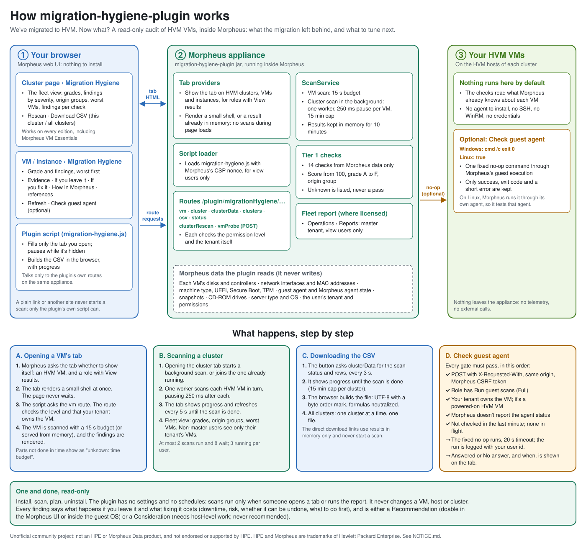

In short:

- **Everything happens on the appliance.** The plugin reads what Morpheus already knows about each VM: disks, controllers and datastores, network interfaces and MAC addresses, machine type, firmware, CPU topology, nested virtualization, placement, guest agent and Morpheus agent state, snapshots, CD-ROM drives and the server type.
- **Tabs are shells; the script fills them.** Page loads never wait for a scan. The plugin's script, loaded with Morpheus's CSP nonce, asks the plugin's routes for results only for the tab you open.
- **Cluster scans run in the background**, paced, cached for 10 minutes, and shared by everyone viewing the same cluster.
- **Optional commands go through Morpheus.** Guest checks use Morpheus's guest execution; the host CPU check uses Morpheus's connection to its hosts. Both are fixed, read-only, on request and cached for an hour.
- **The checks are plain code** with no Morpheus types (`core/Tier1Rules.groovy`, `core/Tier2Rules.groovy`, `core/hostcpu/`), and every check's text lives in one place (`core/Tier1Catalog.groovy`, `core/Tier2Catalog.groovy`): the evidence, "If you leave it", "If you fix it" and references. The `Check` model refuses a check without them. The plan is built from those same fields (`core/TuneUpPlan.groovy`).

The infographic is generated by [`tools/draw-how-it-works.py`](tools/draw-how-it-works.py); edit the text there and run it again to update it.

## Requirements

- HPE Morpheus **9.0.x or 9.1.x** (Plugin API 1.4.1 or later), any edition with HVM clusters: Morpheus VM Essentials, Morpheus Advanced or Morpheus Enterprise. Tested on 9.1.0.1; an earlier version was also tried on 9.0.1.
- HVM clusters. Other cloud types are ignored.
- No network access, credentials or settings: the plugin has no settings form.
- For the optional guest checks: on Windows, a running QEMU guest agent; on Linux, a working Morpheus agent. For the optional host CPU check: Morpheus able to run commands on its HVM hosts (it already does this to manage them).

## Download

Use the prebuilt jar from the [Releases](../../releases) page. There's no need to build anything.

**One jar, `vm-tuneup-morpheus-plugin-<version>.jar`, works on HPE Morpheus 9.0.x and 9.1.x.** It's compiled against the oldest supported Plugin API (1.4.1, Morpheus 9.0), and its whole test suite also runs against Plugin API 1.5.0 (Morpheus 9.1). Before each release, `tools/check-plugin-core.sh` checks HPE's published plugin sources and docs for any compatibility change.

Each release includes `SHA256SUMS`. Check the download with `sha256sum -c SHA256SUMS`.

Then follow **[docs/INSTALL.md](docs/INSTALL.md)**.

## Build from source (optional)

You need only Docker; the build runs in a pinned JDK 17 container.

```bash
git clone https://github.com/grahamfairbank/vm-tuneup-morpheus-plugin.git
cd vm-tuneup-morpheus-plugin
tools/build.sh
```

This runs the tests, builds `dist/vm-tuneup-morpheus-plugin-<version>.jar` against Plugin API 1.4.1, and repeats the tests against Plugin API 1.5.0.

## Limits

These are known, and stated so you can plan around them:

- **Linux guest checks need a working Morpheus agent.** Morpheus runs Linux guest commands through its own agent. An agent that reports in but can't run commands makes the scan end with "no output" (the checks stay unknown). Install or repair the agent, then run the guest checks again.
- **Discovered (unmanaged) VMs can't be guest-scanned through Morpheus.** Morpheus has no guest execution path for them. Convert the VM to managed first (`DISCOVERED`).
- **The Linux guest path isn't verified end to end through Morpheus yet.** The Linux script itself was verified over SSH on Rocky Linux 9 and Ubuntu, and the Windows path was verified through Morpheus on Windows Server 2022.
- **Host CPU recommendations for mixed-CPU clusters are tested with crafted data.** The test lab's hosts are identical, so the mixed-CPU logic (different models, microcode or vendors) is covered by tests with crafted `virsh` output for several CPU generations, not yet by a real mixed cluster.
- **Some Morpheus UI paths aren't verified yet:** changing the cluster's CPU model on an existing cluster (and when running VMs pick it up), and changing cores per socket with Reconfigure. The findings say so under **Not yet verified**, as they do for other fix paths (for example, changing an existing boot disk's controller in place).
- **On Linux, the guest agent check tests the Morpheus agent**, not the QEMU guest agent (see above).
- **Morpheus 9.0.x reports less:** the chipset and guest agent channel checks are unknown there.
- **The fleet report runs from the master tenant only**, and so does the host CPU check.
- **Results live in memory**: scans for 10 minutes, guest and host CPU results for 1 hour. There's no history. Save the CSV or the printable report if you want to compare later.

## Roadmap

- **Verify the Linux guest path** through Morpheus end to end, and the CPU model and cores-per-socket changes in the Morpheus UI.
- **More guest checks:** the guest's own disk usage and other read-only facts from inside the VM.
- **Later, optional:** guided Linux remediation, kept separate from the audit and behind its own permission.

Ideas and pull requests are welcome; see [Contributing](#contributing).

## Contributing

**Pull requests are welcome.** See **[CONTRIBUTING.md](CONTRIBUTING.md)** for how to build, test and submit changes. Use the [issue templates](../../issues/new/choose) for bugs and ideas, and report security problems privately.

## Sources, attribution and trademarks

This plugin was written from scratch, using HPE's public documentation ([docs.morpheusdata.com](https://docs.morpheusdata.com/en/9.1/) and its source on GitHub, [HewlettPackard/morpheus-docs](https://github.com/HewlettPackard/morpheus-docs)) and the Morpheus plugin API as references, and follows the architecture of its sibling project [com-morpheus-plugin](https://github.com/grahamfairbank/com-morpheus-plugin). The guest and host checks also cite libvirt, QEMU, virtio-win, Microsoft and Linux documentation. It is an independent community project, not an HPE product, and isn't supported by HPE. **[NOTICE.md](NOTICE.md)** lists every source, its license and exactly how it was used, how the test data and screenshots were made, and the full trademark notices.

## License

[MIT](LICENSE) for this project's own code. The Morpheus plugin API it compiles against is licensed separately by Morpheus Data, LLC and isn't included.
