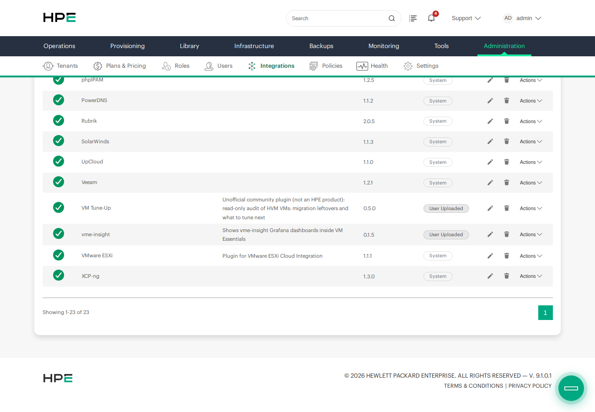
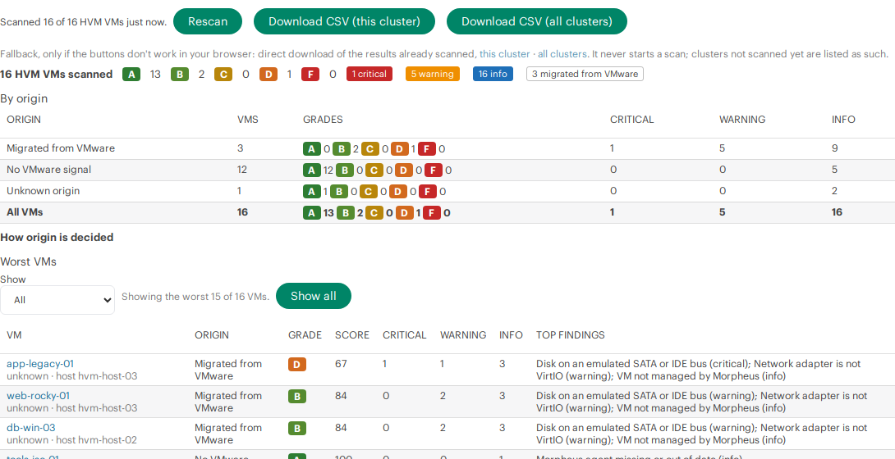

# Installing vm-tuneup-morpheus-plugin

> Unofficial community plugin, not an HPE product and not supported by HPE. See [NOTICE.md](../NOTICE.md).

This guide is for HPE Morpheus 9.0.x and 9.1.x with HVM (HPE Virtual Machine) clusters. It assumes you've never installed a Morpheus plugin before, and that you don't use the Morpheus API. Every step says where to click and what you should see. Allow about 15 minutes, plus the time the first scan takes.

The plugin is "one and done": install it, scan, plan your fixes, and uninstall it when you're finished. It's read-only and has no settings.

*Names and addresses in the screenshots are example values, and each one means the same thing everywhere in this guide and the README:*

| In the examples | Example value |
|---|---|
| Morpheus appliance | `morpheus.example.com`, signed in as `admin` |
| HVM cluster | `cluster-a` |
| HVM hosts | `hvm-host-01`, `hvm-host-02`, `hvm-host-03` |
| A VM with a lot to fix | `app-legacy-01` (boot disk on IDE, e1000 network adapter, discovered, VMware MAC address) |
| A migrated Windows VM | `db-win-01` (guest agent connected) |
| Migrated Linux VMs | `web-rocky-01`, `web-rocky-02` (disks on SATA) |
| Clean VMs | `svc-ubuntu-01`, `svc-ubuntu-02`, `svc-ubuntu-03` |
| IP addresses | `192.0.2.x` (the documentation range) |

## Before you start

You need:

- **Morpheus admin access.** HPE Morpheus **9.0.x or 9.1.x** (VM Essentials, Advanced or Enterprise edition), and a login that can open **Administration → Integrations → Plugins** and **Administration → Roles**.
- **At least one HVM cluster.** The plugin looks only at VMs on HVM clusters; other clouds are ignored.
- **Nothing else.** No network access, no credentials, no API client, no agent on the VMs.

## 1. Download the plugin and check it

1. Open the [Releases](https://github.com/grahamfairbank/vm-tuneup-morpheus-plugin/releases) page and download two files from the newest release:
   - `vm-tuneup-morpheus-plugin-<version>.jar` (the plugin; one jar works on Morpheus 9.0.x and 9.1.x);
   - `SHA256SUMS` (its checksum).
2. Optional but recommended: check that the download is complete and unchanged. In a terminal, in the folder where you saved both files:
   - **Linux or macOS:** run `sha256sum -c SHA256SUMS`. It should print `vm-tuneup-morpheus-plugin-<version>.jar: OK`. (On macOS without `sha256sum`, run `shasum -a 256 -c SHA256SUMS`.)
   - **Windows:** run `certutil -hashfile vm-tuneup-morpheus-plugin-<version>.jar SHA256` and compare the long hexadecimal value with the one in `SHA256SUMS` (open it in Notepad).

   If the values don't match, download the jar again.

## 2. Upload the plugin

1. In Morpheus, go to **Administration → Integrations → Plugins**.
2. Click **+ Add** (on some versions **Add Plugin**), choose the jar and click **Upload**.
3. After a few seconds, **VM Tune-Up** appears in the plugin list, with the version you uploaded and a check mark under **Enabled**.

   

The plugin has no settings: there's nothing to fill in on its edit window.

## 3. Know the two permissions

Installing the plugin adds two permissions to every Morpheus role. Both start at **None**, so nobody sees anything until you grant them.

| Permission | Levels | What it allows |
|---|---|---|
| **VM Tune-Up: View results** | None / Read | The VM Tune-Up tabs on clusters, VMs and instances, Rescan, the CSV downloads and the fleet report. People see only VMs and clusters their tenant owns. |
| **VM Tune-Up: Run guest scans** | None / Full | Optional. The **Check guest agent** button: one harmless no-op command run inside the VM to see whether its agent answers. It changes nothing in the VM. Give it only to people you'd let run commands in those VMs. |

People who view the results also see what the checks are about for their tenant's VMs: MAC addresses, attached ISO paths, host and cluster names, and OS and agent versions. Grant **View results** to the people you'd show those settings to.

## 4. Give people access

Pick **one** of these two ways.

### Option A: add the permission to an existing role (in the Morpheus UI)

Use this for administrators, or for a role that can already see your clusters and VMs.

1. Go to **Administration → Roles** and click the role's name (for example the role your administrators use).
2. On the **Features** tab, type `VM Tune-Up` in the search box.
3. Set **VM Tune-Up: View results** to **Read**.
4. Optional: set **VM Tune-Up: Run guest scans** to **Full** for people who should be able to run **Check guest agent**.
5. The change is saved as you choose each level. People with that role see the tabs the next time they load a page.


### Option B: let the script make a ready-made read-only role and user

People who plan the post-migration work often need to see clusters and VMs and these results, without being able to change anything else in Morpheus. Making that role by hand means setting each feature permission, one dropdown at a time: well over a hundred clicks, easy to get wrong, and repeated on every appliance. [`tools/create-readonly-user.py`](../tools/create-readonly-user.py) does it in about a minute.

**What you need:** Python 3.8 or later on any computer that can reach the Morpheus appliance (your laptop is fine; on Windows, install Python from python.org and type `py` instead of `python3`). Nothing else: the script uses only Python's standard library. Install the plugin first (step 2): the plugin's permissions exist only while it's installed.

1. Download [`tools/create-readonly-user.py`](../tools/create-readonly-user.py) from the repository (on GitHub, open the file and choose **Download raw file**).
2. In a terminal, in the folder where you saved it, run:

   ```bash
   python3 create-readonly-user.py morpheus.example.com
   ```

   Use your appliance's host name or IP address in place of `morpheus.example.com`. Add `--guest-scan` at the end to also allow **Check guest agent** for this user, and `--port <n>` if the appliance doesn't use port 443.

3. Answer the prompts:
   - **Certificate:** if the appliance uses a self-signed certificate, the script shows its fingerprint and asks whether to trust it for this run. Compare it with the appliance's certificate if you can, then answer `y`.
   - **Admin username and password:** an administrator login, used only for this run. The password isn't shown as you type.
   - **Name for the read-only role:** press Enter for `vm-tuneup-viewer`, or type your own.
   - **Username, email and password for the read-only user.** Morpheus requires an email; any address you control will do.
4. The script then:
   - creates the role and sets **Read** on the pages the tabs live on, and nothing else: **Operations: Dashboard** (the landing page) and **Infrastructure: Compute, Clusters, Groups** and **Clouds**;
   - gives the role read access to all groups and clouds, so those pages list your clusters and VMs;
   - sets **VM Tune-Up: View results** to **Read**, and **Run guest scans** to **Full** only with `--guest-scan` (otherwise **None**);
   - leaves **every other permission at None**;
   - **reads the role back and checks it.** If anything else is above None, it stops before creating the user and tells you what to review;
   - creates the user, deletes the admin token it used for its own login, and prints an API token for the new user.

At the end it lists what it granted. The new person signs in to Morpheus with the username and password as usual; they don't need the API token, so you can ignore it (it's printed only on screen, never saved).

**What it leaves behind:** the new role, the new user and that user's token. Nothing else: it writes no files and keeps no logs. To undo it, delete the user in **Administration → Users** and the role in **Administration → Roles**. If the script says the role has no VM Tune-Up permissions, the plugin isn't installed or is disabled: finish step 2 first, delete the empty role it mentions, and run it again.

To give the role to existing users instead: **Administration → Users → (user) → Edit → Roles**.

## 5. Scan a cluster

1. Go to **Infrastructure → Clusters** and click an HVM cluster (`cluster-a` in the examples).
2. Open the **VM Tune-Up** tab. Morpheus puts extra tabs under the overflow menu at the right end of the tab row, so look there if you don't see it.
3. The first time, the tab scans every HVM VM in the cluster in the background and shows its progress ("Scanned 4 of 9 HVM VMs"). It refreshes by itself every 5 seconds. A cluster of a few dozen VMs takes a few minutes; you can leave the page and come back, and the scan carries on.
4. When the scan is done, you see the fleet view: grade counts, findings by severity, **By origin**, **Worst VMs** and **Findings per check**.

   

5. Use the **Show** filter above **Worst VMs** to see only one origin group (**Migrated**, **No VMware signal** or **Unknown origin**). Open **How origin is decided** to see what each group means. **Show all** lists every VM, not just the 15 worst.

   

Results are kept for 10 minutes. Click **Rescan** to scan again after you've fixed something.

## 6. Look at a VM

1. In **Worst VMs**, click a VM's name (`app-legacy-01` in the examples). Or go to **Infrastructure → Compute → Virtual Machines → (VM)**, or to the VM's instance under **Provisioning → Instances**.
2. Open its **VM Tune-Up** tab (again, it may be in the overflow menu).
3. You see the VM's grade and its findings, worst first. Click a finding to see the evidence, **If you leave it**, **If you fix it** (downtime, risk, whether it can be undone), **Do first, in this order**, **How in Morpheus** and the references.

   

4. **Unknown or not evaluated** lists the checks the plugin couldn't decide for this VM, and why. They cost no points.
5. **Refresh** scans this VM again.

### Check guest agent (optional)

If Morpheus doesn't report the VM's QEMU guest agent status, the tab shows a **Check guest agent** area.

- With **Run guest scans** at **Full**, click **Check guest agent**. Within 20 seconds it shows **Answered** (the agent works) or **No answer** with a short reason, and when it ran. You can run it once a minute per VM.
- Without that permission, the explanation is greyed out with "You don't have permission".


What the result means:

| VM | Answered | No answer |
|---|---|---|
| **Windows** | The QEMU guest agent works: the check passes. | The QEMU guest agent didn't answer: the check fails. Install or start the QEMU Guest Agent service (from the virtio-win guest tools). |
| **Linux** | Morpheus runs the command through **its own Morpheus agent**, so this shows the Morpheus agent answers. The check passes. | The check stays **unknown**, not failed: it says nothing about the QEMU guest agent. Check `systemctl status qemu-guest-agent` inside the VM. |

## 7. Download the CSV

1. On the cluster's **VM Tune-Up** tab, click **Download CSV (this cluster)**, or **Download CSV (all clusters)** for every HVM cluster you can see.
2. The status line beside the buttons shows progress ("Preparing CSV: scanned 12 of 63…"). If a cluster hasn't been scanned yet, the button starts the scan and waits for it.
3. Your browser saves `vm-tuneup-<cluster>-<date>.csv`. It opens directly in Excel and other spreadsheets, one row per VM, worst first.


The **direct download** links under the buttons are a fallback for browsers where the buttons don't work. They only use results already in memory and never start a scan.

**On a license with Reports**, you can also run the fleet report from the master tenant: **Operations → Reports → VM Tune-Up → Run**. Morpheus stores each run and can export its rows as CSV. On Morpheus VM Essentials, which has no Reports page, use the cluster tab and the CSV.

## Upgrading

Upload the new jar the same way (step 2). It replaces the earlier version. Roles keep their VM Tune-Up permissions. Results in memory are dropped, so the next tab you open scans again.

## Uninstalling when you're done

1. Go to **Administration → Integrations → Plugins** and delete **VM Tune-Up** (or disable it to keep it for later).
2. The plugin's threads stop and its results are dropped. It never changed a VM, host or cluster, so there's nothing to undo there.
3. Clean up what you made for it: the role and user from step 4 (if you used the script), and any fleet report runs you stored under **Operations → Reports**, if you don't want to keep them.

## Troubleshooting

| What you see | What it means / what to do |
|---|---|
| No **VM Tune-Up** tab | Look under the overflow menu at the right end of the tab row. The tab appears only on HVM clusters, HVM VMs and their instances, and only for roles with **VM Tune-Up: View results** at **Read** (reload the page after changing a role). |
| The tab stays on "Loading…" | The plugin's script didn't load. Reload the page. After 15 seconds the tab also shows a link to the results already in memory. |
| "Not scanned yet. Open the VM Tune-Up tab of this cluster to start a scan." | You opened a plugin link directly (for example a bookmark or a new browser tab). Direct links never start a scan, for security. Open the cluster's VM Tune-Up tab in Morpheus instead. |
| "Reload the page and sign in again." | Your Morpheus session expired. Reload the page and sign in. |
| "too many scans in progress, try again shortly" | Up to 2 cluster scans run at once (3 per user), and up to 8 wait. Wait for one to finish. |
| "Your role needs "VM Tune-Up: View results" at read access." | Add the permission to your role (step 4). |
| **Check guest agent** is missing | Either Morpheus reports the agent's status for this VM (no check needed), the VM is powered off, or it isn't an HVM VM. |
| "You don't have permission" next to the guest agent explanation | Your role needs **VM Tune-Up: Run guest scans** at **Full**. |
| Guest agent check on Linux shows **unknown** after "No answer" | Expected: on Linux, Morpheus runs the command through its Morpheus agent, so no answer says nothing about the QEMU guest agent. See [Check guest agent](#check-guest-agent-optional). |
| A check is **unknown** on every VM | On Morpheus 9.0.x, the chipset and guest agent channel checks are always unknown: Morpheus doesn't report those fields there. Discovered VMs have the same gap. |
| CSV button: "HTTP 403: …" | Your role lacks the view permission. |
| Direct download: "The scan of this cluster is still running. Try the download again in a minute." (HTTP 202) | Wait for the scan to finish, or use the **Download CSV** buttons, which wait for you. |
| Direct download: "Not scanned yet. Open the VM Tune-Up tab of this cluster…" (HTTP 409) | The direct link only uses results from the last 10 minutes. Open the cluster tab first, or use the buttons. |
| Direct download: "None of the N clusters are scanned yet…" (HTTP 409) | The same, for all clusters. Use **Download CSV (all clusters)**. |
| Direct download: "The direct download is not available on this appliance…" (HTTP 406) | This appliance can't serve the file as a download. Use the **Download CSV** buttons. |
| The CSV has fewer VMs than the cluster, with a note | The scan hit its 15-minute limit; the file has the VMs scanned so far. Click **Rescan**, wait, and download again. |
| Upload: nothing happens, or "Failed to parse plugin file" | The download is incomplete or corrupt: check it against `SHA256SUMS` (step 1). |
| Fleet report: one row saying the view permission is needed | Only users with **VM Tune-Up: View results** can run the report, from the master tenant. |

The plugin logs to the Morpheus application log (**Administration → Health → Morpheus Logs**, or `/var/log/morpheus/morpheus-ui/current` on the appliance) with the prefix `vm-tuneup:`. Each guest agent check is logged with the Morpheus user id and server id.

How the pieces fit together is shown in the [How it works](../README.md#how-it-works) infographic.
