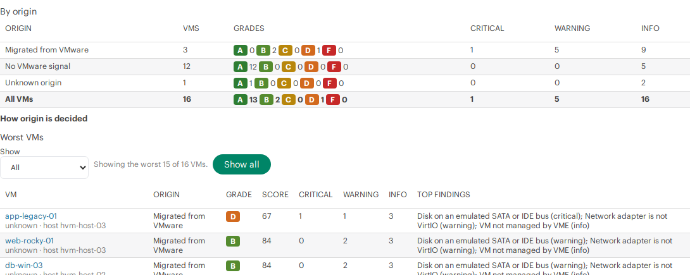
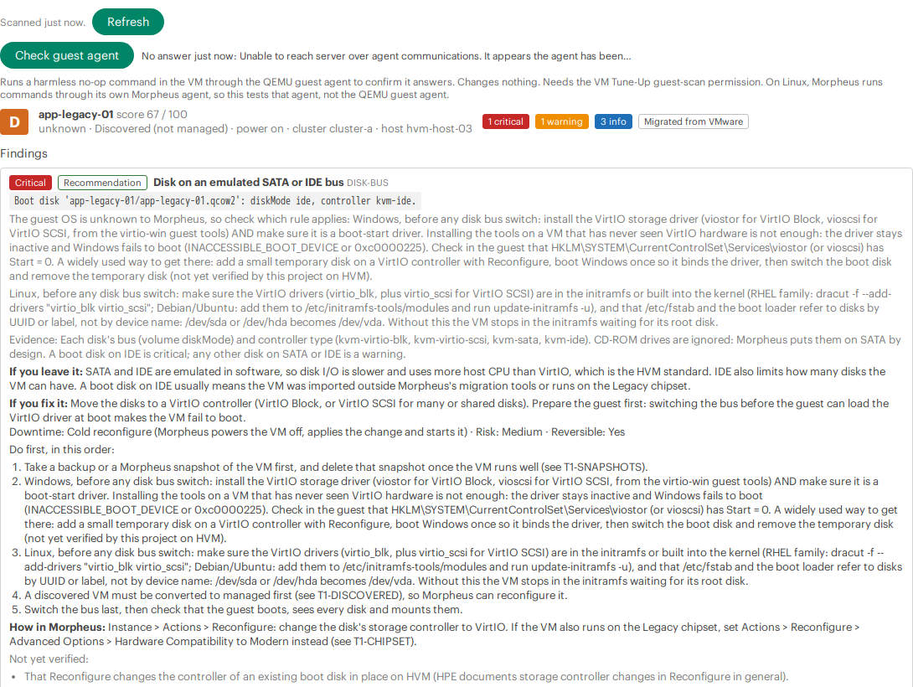
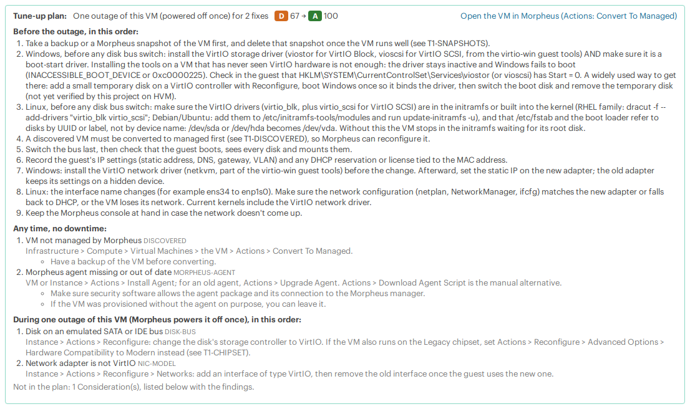
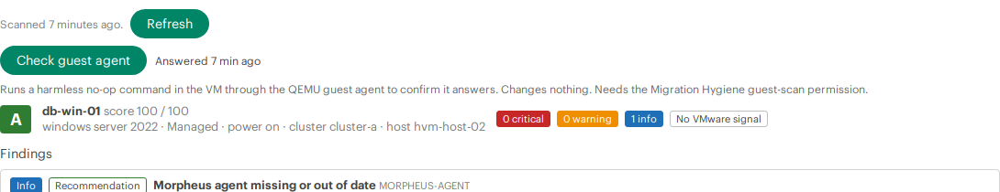
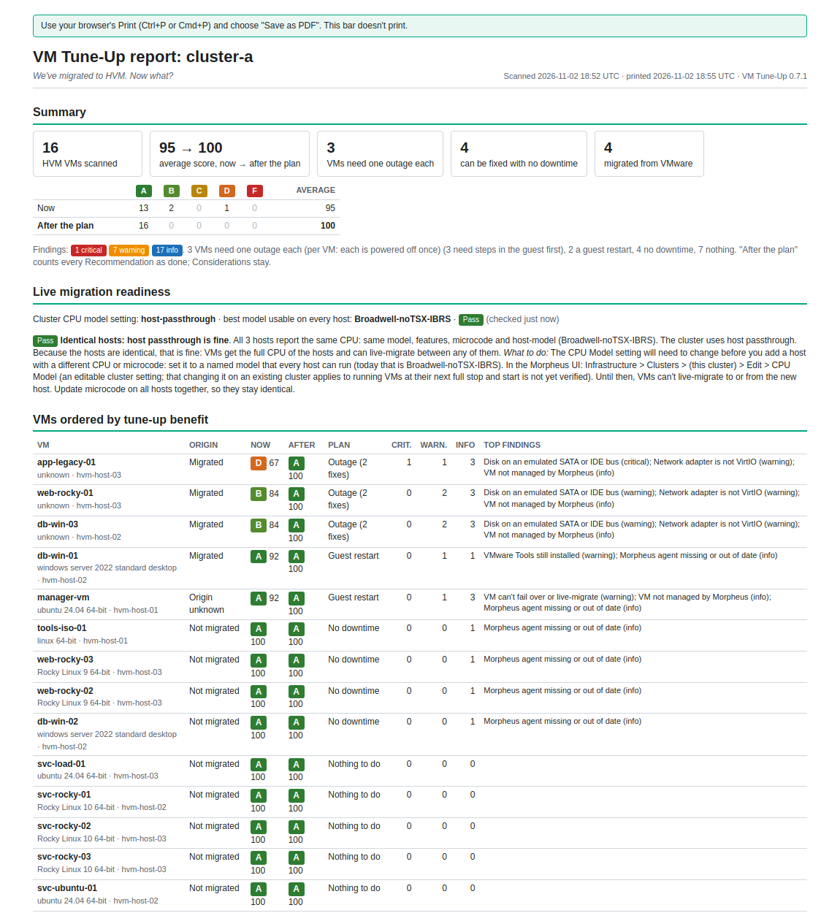
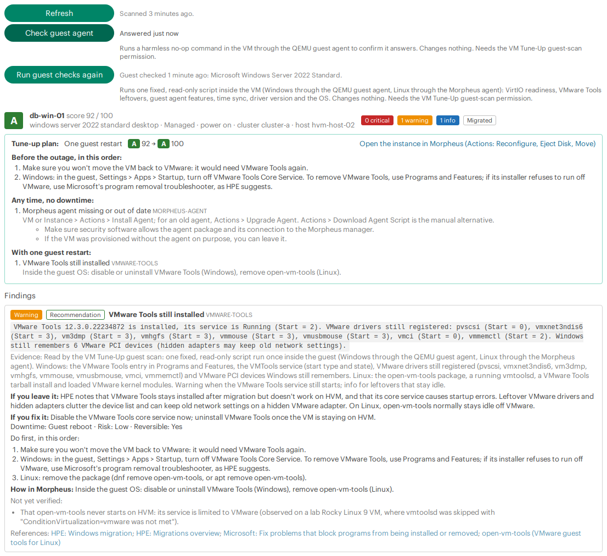
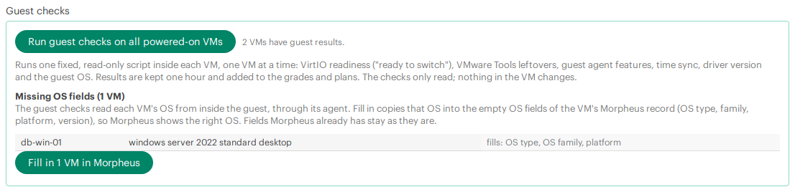
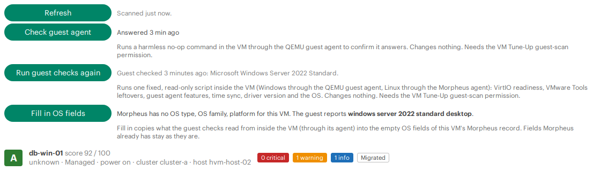
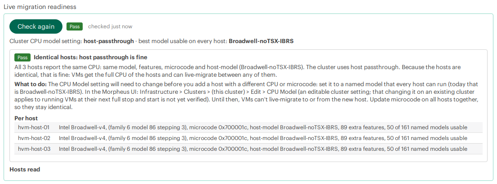

# Installing vm-tuneup-morpheus-plugin

> Unofficial community plugin, not an HPE product and not supported by HPE. See [NOTICE.md](../NOTICE.md).

This guide is for HPE Morpheus 9.0.x and 9.1.x with HVM (HPE Virtual Machine) clusters. It assumes you've never installed a Morpheus plugin before, and that you don't use the Morpheus API. Every step says where to click and what you should see. Allow about 15 minutes, plus the time the first scan takes.

The plugin is "one and done": install it, scan, plan your fixes, and uninstall it when you're finished. It has no settings. It's read-only, except for one opt-in action (**Fill in OS fields**, step 9) that only people you give its own permission can use.

> **You never enter credentials anywhere.** Not a Morpheus API key, not a guest password, SSH key or WinRM login, not a host account, not per user and not per VM. The plugin has no settings form and stores no secret. It reaches VMs through Morpheus guest execution (the QEMU guest agent on Windows, the Morpheus agent on Linux) and hosts through Morpheus's own connection. What you set up is **role permissions** (step 3) and, for the optional guest checks, a **working agent in each VM** (step 8). Details: [README: No credentials](../README.md#no-credentials-what-each-vm-and-host-needs-instead).

*Names and addresses in the screenshots are example values, and each one means the same thing everywhere in this guide and the README:*

| In the examples | Example value |
|---|---|
| Morpheus appliance | `morpheus.example.com`, signed in as `admin` |
| HVM cluster | `cluster-a` |
| HVM hosts | `hvm-host-01`, `hvm-host-02`, `hvm-host-03` |
| A VM with a lot to fix | `app-legacy-01` (boot disk on IDE, e1000 network adapter, discovered, VMware MAC address) |
| A migrated Windows VM | `db-win-01` (guest agent connected, VMware Tools still installed, empty OS fields) |
| Migrated Linux VMs | `web-rocky-01`, `web-rocky-02` (disks on SATA) |
| Clean VMs | `svc-ubuntu-01`, `svc-ubuntu-02`, `svc-ubuntu-03` |
| IP addresses | `192.0.2.x` (the documentation range) |

## Before you start

You need:

- **Morpheus admin access.** HPE Morpheus **9.0.x or 9.1.x** (VM Essentials, Advanced or Enterprise edition), and a login that can open **Administration → Integrations → Plugins** and **Administration → Roles**.
- **At least one HVM cluster.** The plugin looks only at VMs on HVM clusters; other clouds are ignored.
- **Nothing else.** No network access, no credentials, no API client, no agent to install.
- **For the optional guest checks only:** on Windows VMs, a running QEMU guest agent; on Linux VMs, a working Morpheus agent. Morpheus uses these to run commands in the guest.

## 1. Download the plugin and check it

1. Open the [Releases](https://github.com/grahamfairbank/vm-tuneup-morpheus-plugin/releases) page and download two files from the newest release:
   - `vm-tuneup-morpheus-plugin-<version>.jar` (the plugin; one jar works on Morpheus 9.0.x and 9.1.x);
   - `SHA256SUMS` (its checksum).
2. Optional but recommended: check that the download is complete and unchanged. In a terminal, in the folder where you saved both files:
   - **Linux or macOS:** run `sha256sum -c SHA256SUMS`. It should print `vm-tuneup-morpheus-plugin-<version>.jar: OK`. (On macOS without `sha256sum`, run `shasum -a 256 -c SHA256SUMS`.)
   - **Windows:** run `certutil -hashfile vm-tuneup-morpheus-plugin-<version>.jar SHA256` and compare the long hexadecimal value with the one in `SHA256SUMS` (open it in Notepad).

   If the values don't match, download the jar again.

## 2. Upload the plugin

1. In Morpheus, go to **Administration → Integrations → Plugins**.
2. Click **+ Add** (on some versions **Add Plugin**), choose the jar and click **Upload**.
3. After a few seconds, **VM Tune-Up** appears in the plugin list, with the version you uploaded and a check mark under **Enabled**.

   

The plugin has no settings: there's nothing to fill in on its edit window.

## 3. Know the three permissions

Installing the plugin adds three permissions to every Morpheus role. All start at **None**, so nobody sees anything until you grant them.

| Permission | Levels | What it allows |
|---|---|---|
| **VM Tune-Up: View results** | None / Read | The VM Tune-Up tabs on clusters, VMs and instances, the tune-up plans, Rescan, the CSV downloads, the printable report and the fleet report. People see only VMs and clusters their tenant owns. |
| **VM Tune-Up: Run guest and host checks** | None / Full | Optional. Read-only commands, run through Morpheus: **Check guest agent** (a no-op command in the VM; it also runs for each powered-on VM when this person's cluster scan runs), and, only when the person clicks, **Run guest checks** (one fixed, read-only script in the VM) and, for master-tenant users, **Check host CPUs** (two read-only `virsh` commands on each HVM host). None of them changes anything. Give it only to people you'd let run commands in those VMs and on those hosts. |
| **VM Tune-Up: Update VM records** | None / Full | Optional. **Fill in OS fields**: the plugin's only write. It fills a VM's **empty** guest OS fields in Morpheus from what the guest checks found, after a confirm, and never changes a field Morpheus already has. Give it to people who may edit those VMs in Morpheus. |

People who view the results also see what the checks are about for their tenant's VMs: MAC addresses, attached ISO paths, host and cluster names, OS and agent versions, and what the guest checks found inside the guest. Grant **View results** to the people you'd show those settings to.

## 4. Give people access

Pick **one** of these two ways.

### Option A: add the permission to an existing role (in the Morpheus UI)

Use this for administrators, or for a role that can already see your clusters and VMs.

1. Go to **Administration → Roles** and click the role's name (for example the role your administrators use).
2. On the **Features** tab, type `VM Tune-Up` in the search box.
3. Set **VM Tune-Up: View results** to **Read**.
4. Optional: set **VM Tune-Up: Run guest and host checks** to **Full** for people who should be able to run **Check guest agent**, **Run guest checks** and **Check host CPUs**.
5. Optional: set **VM Tune-Up: Update VM records** to **Full** for people who should be able to use **Fill in OS fields**.
6. The change is saved as you choose each level. People with that role see the tabs the next time they load a page.


### Option B: let the script make a ready-made read-only role and user

People who plan the post-migration work often need to see clusters and VMs and these results, without being able to change anything else in Morpheus. Making that role by hand means setting each feature permission, one dropdown at a time: well over a hundred clicks, easy to get wrong, and repeated on every appliance. [`tools/create-readonly-user.py`](../tools/create-readonly-user.py) does it in about a minute.

**What you need:** Python 3.8 or later on any computer that can reach the Morpheus appliance (your laptop is fine; on Windows, install Python from python.org and type `py` instead of `python3`). Nothing else: the script uses only Python's standard library. Install the plugin first (step 2): the plugin's permissions exist only while it's installed.

1. Download [`tools/create-readonly-user.py`](../tools/create-readonly-user.py) from the repository (on GitHub, open the file and choose **Download raw file**).
2. In a terminal, in the folder where you saved it, run:

   ```bash
   python3 create-readonly-user.py morpheus.example.com
   ```

   Use your appliance's host name or IP address in place of `morpheus.example.com`. Add `--guest-scan` at the end to also allow **Check guest agent**, **Run guest checks** and **Check host CPUs** for this user, and `--port <n>` if the appliance doesn't use port 443.

3. Answer the prompts:
   - **Certificate:** if the appliance uses a self-signed certificate, the script shows its fingerprint and asks whether to trust it for this run. Compare it with the appliance's certificate if you can, then answer `y`.
   - **Admin username and password:** an administrator login, used only for this run. The password isn't shown as you type.
   - **Name for the read-only role:** press Enter for `vm-tuneup-viewer`, or type your own.
   - **Username, email and password for the read-only user.** Morpheus requires an email; any address you control will do.
4. The script then:
   - creates the role and sets **Read** on the pages the tabs live on, and nothing else: **Operations: Dashboard** (the landing page) and **Infrastructure: Compute, Clusters, Groups** and **Clouds**;
   - gives the role read access to all groups and clouds, so those pages list your clusters and VMs;
   - sets **VM Tune-Up: View results** to **Read**, and **Run guest and host checks** to **Full** only with `--guest-scan` (otherwise **None**);
   - never grants **Update VM records**: the role stays read-only. If this user should fill in OS fields, set that permission by hand (Option A);
   - leaves **every other permission at None**;
   - **reads the role back and checks it.** If anything else is above None, it stops before creating the user and tells you what to review;
   - creates the user, deletes the admin token it used for its own login, and prints an API token for the new user.

At the end it lists what it granted. The new person signs in to Morpheus with the username and password as usual; they don't need the API token, so you can ignore it (it's printed only on screen, never saved).

**What it leaves behind:** the new role, the new user and that user's token. Nothing else: it writes no files and keeps no logs. To undo it, delete the user in **Administration → Users** and the role in **Administration → Roles**. If the script says the role has no VM Tune-Up permissions, the plugin isn't installed or is disabled: finish step 2 first, delete the empty role it mentions, and run it again.

To give the role to existing users instead: **Administration → Users → (user) → Edit → Roles**.

## 5. Scan a cluster

1. Go to **Infrastructure → Clusters** and click an HVM cluster (`cluster-a` in the examples).
2. Open the **VM Tune-Up** tab. Morpheus puts extra tabs under the overflow menu at the right end of the tab row, so look there if you don't see it.
3. The first time, the tab scans every HVM VM in the cluster in the background and shows its progress ("Scanned 4 of 9 HVM VMs"). It refreshes by itself every 5 seconds. A cluster of a few dozen VMs takes a few minutes; you can leave the page and come back, and the scan carries on.
4. When the scan is done, you see the fleet view: grade counts, findings by severity, the **Tune-up plan** summary (grades **Now** and **After the plan**, and how many VMs need one cold window, a guest restart, no downtime or nothing), **Host CPUs**, **Guest checks**, **By origin**, **Worst VMs** and **Findings per check**. A small activity indicator shows while anything is running.

   

5. **Worst VMs** shows each VM's grade now and after the plan, and its plan's window. Use the **Show** filter above it to see only one origin group (**Migrated**, **No VMware signal** or **Unknown origin**). Open **How origin is decided** to see what each group means. **Show all** lists every VM, not just the 15 worst.

   

Results are kept for 10 minutes. Click **Rescan** to scan again after you've fixed something.

## 6. Look at a VM

1. In **Worst VMs**, click a VM's name (`app-legacy-01` in the examples). Or go to **Infrastructure → Compute → Virtual Machines → (VM)**, or to the VM's instance under **Provisioning → Instances**.
2. Open its **VM Tune-Up** tab (again, it may be in the overflow menu).
3. You see the VM's grade, its **tune-up plan** and its findings, worst first.
   - The plan says what window the VM needs (**One cold window**, **One guest restart**, **No downtime** or **Nothing to do**) and its grade now and after the plan. It then lists **Before the window, in this order** (prerequisites, once each), **Any time, no downtime**, **With one guest restart** and **In one cold window, in this order**.
   - **Open the instance in Morpheus** (or the VM) takes you to the page where the actions are (**Actions → Reconfigure**, **Eject Disk**, **Move**).
   - Click a finding to see the evidence, **If you leave it**, **If you fix it** (downtime, risk, whether it can be undone), **Do first, in this order**, **How in Morpheus** and the references.

   

<!-- Screenshot to add (see images/SCREENSHOT-SPEC.md):  -->

4. **Unknown or not evaluated** lists the checks the plugin couldn't decide for this VM, and why. They cost no points.
5. **Refresh** scans this VM again.

### Check guest agent (optional)

If Morpheus doesn't report the VM's QEMU guest agent status, the tab shows a **Check guest agent** area.

- With **Run guest and host checks** at **Full**, click **Check guest agent**. Within 20 seconds it shows **Answered** (the agent works) or **No answer** with a short reason, and when it ran. You can run it once a minute per VM.
- Without that permission, the explanation is greyed out with "You don't have permission".



What the result means:

| VM | Answered | No answer |
|---|---|---|
| **Windows** | The QEMU guest agent works: the check passes. | The QEMU guest agent didn't answer: the check fails. Install or start the QEMU Guest Agent service (from the virtio-win guest tools). |
| **Linux** | Morpheus runs the command through **its own Morpheus agent**, so this shows the Morpheus agent answers. The check passes. | The check stays **unknown**, not failed: it says nothing about the QEMU guest agent. Check `systemctl status qemu-guest-agent` inside the VM. |

## 7. Download the CSV or print the report

1. On the cluster's **VM Tune-Up** tab, click **Download CSV (this cluster)**, or **Download CSV (all clusters)** for every HVM cluster you can see.
2. The status line beside the buttons shows progress ("Preparing CSV: scanned 12 of 63…"). If a cluster hasn't been scanned yet, the button starts the scan and waits for it.
3. Your browser saves `vm-tuneup-<cluster>-<date>.csv`. It opens directly in Excel and other spreadsheets, one row per VM, worst first. Four columns describe the plan: `gradeAfter`, `scoreAfter`, `planWindow` (`cold`, `guest-reboot`, `live` or `none`) and `planSteps` (the plan's checks in order).

The **direct download** links under the buttons are a fallback for browsers where the buttons don't work. They only use results already in memory and never start a scan.

To print the cluster's report, or save it as a PDF:

1. Wait until the cluster scan is done (and run the guest checks and the host CPU check first, if you want them in the report).
2. Click **Print report**. A new page opens with a summary, all VMs worst first (grade now and after the plan), the tune-up plan of each VM, and the host CPU result.
3. Use your browser's **Print** (Ctrl+P or Cmd+P) and choose **Save as PDF**. The bar at the top of the page doesn't print.

The report uses only results already scanned. It never starts a scan or runs a command; if the cluster is still scanning, it says "Not ready yet".

<!-- Screenshot to add (see images/SCREENSHOT-SPEC.md):  -->

**On a license with Reports**, you can also run the fleet report from the master tenant: **Operations → Reports → VM Tune-Up → Run**. Morpheus stores each run and can export its rows as CSV. On Morpheus VM Essentials, which has no Reports page, use the cluster tab, the CSV and the printable report.

## 8. Run the guest checks (optional)

The guest checks look inside the VM for what Morpheus data can't show: whether the VirtIO drivers are ready before you switch a disk bus ("ready to switch"), VMware Tools leftovers, guest agent features (file system freeze for consistent snapshots), time sync, the VirtIO driver version and the guest OS. They need **Run guest and host checks** at **Full**.

- **One VM:** on the VM's **VM Tune-Up** tab, click **Run guest checks**. The tab shows "Running the guest checks inside the VM (this can take a few minutes)…" and refreshes by itself. When it's done, it shows "Guest checked just now: <OS>", and the new findings join the grade and the plan.
- **The whole cluster:** on the cluster tab, under **Guest checks**, click **Run guest checks on all powered-on VMs**. It checks one VM at a time (up to 200 VMs, skipping VMs checked in the last hour, for at most 90 minutes) and shows "Running guest checks: 3 of 12 VMs…".

What happens:

- Morpheus runs **one fixed, read-only script** inside the VM: PowerShell through the **QEMU guest agent** on Windows, `sh` through the **Morpheus agent** on Linux. You don't enter any password: Morpheus uses the channel it already has. The [README](../README.md#guest-checks-tier-2) lists everything each script reads.
- The script changes nothing in the VM: no files written, no settings changed, nothing installed, no network connections.
- Each run is logged on the appliance with your Morpheus user id, the server id and the script's SHA-256. The output itself isn't logged.
- Results are kept for **1 hour**; then the Tier 2 findings drop off until someone runs the checks again. Each VM can be checked at most once a minute, and each run has a 2-minute limit.

Powered-off VMs, VMs that aren't HVM VMs and discovered (unmanaged) VMs can't be checked.

<!-- Screenshot to add (see images/SCREENSHOT-SPEC.md):  -->

<!-- Screenshot to add (see images/SCREENSHOT-SPEC.md):  -->

## 9. Fill in OS fields (optional)

After a migration, Morpheus often has no OS type for a VM. Once the guest checks have identified the OS, someone with **Update VM records** at **Full** can fill the empty fields in. This is the plugin's only write.

- **One VM:** the VM tab shows "Morpheus has no OS type, OS family, platform for this VM. The guest reports <OS>." Click **Fill in OS fields**, read the question and click **OK**.
- **The whole cluster:** under **Guest checks** on the cluster tab, **Missing OS fields** lists each VM, the OS the guest reported, and the fields it would fill. Click **Fill in all N** and confirm.

Only **empty** fields are filled (OS type, OS family, platform and version). A field Morpheus already has is never changed. If the guest's OS has no confident match in Morpheus's OS type list, nothing is written and the tab says to set it by hand. Each write is logged with your user id, the server id and the OS code. To undo it, edit the VM in Morpheus and set the fields back.

Without the permission, people see the same note greyed out: "A user with "VM Tune-Up: Update VM records" can fill these in from here."

<!-- Screenshot to add (see images/SCREENSHOT-SPEC.md):  -->

## 10. Check the host CPUs (optional)

The host CPU check makes sure every HVM host in the cluster can run the cluster's CPU model setting, so VMs can live-migrate between hosts. It needs **Run guest and host checks** at **Full** and a user in the **master tenant**.

1. On the cluster tab, in **Host CPUs**, click **Check host CPUs**. The tab shows "Reading each host's CPU with virsh…".
2. Morpheus runs two read-only commands on each HVM host of the cluster: `virsh capabilities` and `virsh domcapabilities --virttype kvm`. You don't enter any password: Morpheus uses its own connection to the hosts.
3. The result shows the **Cluster CPU model setting**, the best named CPU model every host can run, a finding (for example **Pass: Hosts have identical CPUs**), **What to do**, and **Per host** details.

If the result recommends a change, make it in **Infrastructure → Clusters → (cluster) → Edit**. The new model reaches each VM at its next full stop and start, and then test a live migration both ways (both not yet verified on HVM; see the finding's notes). The result is kept for 1 hour; **Check again** runs it again.

<!-- Screenshot to add (see images/SCREENSHOT-SPEC.md):  -->

## Upgrading

Upload the new jar the same way (step 2). It replaces the earlier version. Roles keep their VM Tune-Up permissions; a permission added by the new version (for example **Update VM records**, new in 0.7.0) starts at **None**. Results in memory are dropped, so the next tab you open scans again.

## Uninstalling when you're done

1. Go to **Administration → Integrations → Plugins** and delete **VM Tune-Up** (or disable it to keep it for later).
2. The plugin's threads stop and its results are dropped. It never changed a VM's hardware, a host or a cluster, so there's nothing to undo there. OS fields filled in with **Fill in OS fields** stay, as normal Morpheus data.
3. Clean up what you made for it: the role and user from step 4 (if you used the script), and any fleet report runs you stored under **Operations → Reports**, if you don't want to keep them.

## Troubleshooting

| What you see | What it means / what to do |
|---|---|
| No **VM Tune-Up** tab | Look under the overflow menu at the right end of the tab row. The tab appears only on HVM clusters, HVM VMs and their instances, and only for roles with **VM Tune-Up: View results** at **Read** (reload the page after changing a role). |
| The tab stays on "Loading…" | The plugin's script didn't load. Reload the page. After 15 seconds the tab also shows a link to the results already in memory. |
| "Not scanned yet. Open the VM Tune-Up tab of this cluster to start a scan." | You opened a plugin link directly (for example a bookmark or a new browser tab). Direct links never start a scan, for security. Open the cluster's VM Tune-Up tab in Morpheus instead. |
| "Reload the page and sign in again." | Your Morpheus session expired. Reload the page and sign in. |
| "too many scans in progress, try again shortly" | Up to 2 cluster scans run at once (3 per user), and up to 8 wait. Wait for one to finish. |
| "Your role needs "VM Tune-Up: View results" at read access." | Add the permission to your role (step 4). |
| **Check guest agent** is missing | Either Morpheus reports the agent's status for this VM (no check needed), the VM is powered off, or it isn't an HVM VM. |
| "You don't have permission" next to the guest agent explanation | Your role needs **VM Tune-Up: Run guest and host checks** at **Full**. |
| Guest agent check on Linux shows **unknown** after "No answer" | Expected: on Linux, Morpheus runs the command through its Morpheus agent, so no answer says nothing about the QEMU guest agent. See [Check guest agent](#check-guest-agent-optional). |
| A check is **unknown** on every VM | On Morpheus 9.0.x, the chipset and guest agent channel checks are always unknown: Morpheus doesn't report those fields there. Discovered VMs have the same gap. |
| CSV button: "HTTP 403: …" | Your role lacks the view permission. |
| Direct download: "The scan of this cluster is still running. Try the download again in a minute." (HTTP 202) | Wait for the scan to finish, or use the **Download CSV** buttons, which wait for you. |
| Direct download: "Not scanned yet. Open the VM Tune-Up tab of this cluster…" (HTTP 409) | The direct link only uses results from the last 10 minutes. Open the cluster tab first, or use the buttons. |
| Direct download: "None of the N clusters are scanned yet…" (HTTP 409) | The same, for all clusters. Use **Download CSV (all clusters)**. |
| Direct download: "The direct download is not available on this appliance…" (HTTP 406) | This appliance can't serve the file as a download. Use the **Download CSV** buttons. |
| The CSV has fewer VMs than the cluster, with a note | The scan hit its 15-minute limit; the file has the VMs scanned so far. Click **Rescan**, wait, and download again. |
| Upload: nothing happens, or "Failed to parse plugin file" | The download is incomplete or corrupt: check it against `SHA256SUMS` (step 1). |
| Fleet report: one row saying the view permission is needed | Only users with **VM Tune-Up: View results** can run the report, from the master tenant. |
| No **Run guest checks** button, or "Needs "VM Tune-Up: Run guest and host checks" at full." | Your role needs **VM Tune-Up: Run guest and host checks** at **Full** (step 4). |
| "Guest checks need the VM powered on." | Start the VM, then run the guest checks. |
| "Wait for the cluster scan to finish, then run the guest checks." | The cluster tab's button checks the VMs of the finished scan. Wait for it, then click again. |
| Guest checks on a Linux VM: "The guest scan returned no output." or "no answer from the guest in time" | Linux guest checks go through the **Morpheus agent**. If the agent reports in but can't run commands, the scan gets no output. Check the agent in the VM (and **Actions → Install Agent** or **Upgrade Agent** in Morpheus), then run the checks again. |
| Guest checks on a Windows VM: no output or no answer | The QEMU guest agent must be running in the VM. Run **Check guest agent** first; install the guest agent from the virtio-win guest tools if it doesn't answer. |
| Guest checks on a discovered (unmanaged) VM don't run | Morpheus can't run commands in a discovered VM. Convert it to managed first (the `DISCOVERED` finding says how). |
| Tier 2 findings disappeared | Guest check results are kept for 1 hour. Run the guest checks again. |
| No **Fill in OS fields** button, or "Your role needs "VM Tune-Up: Update VM records" at full to fill in VM records." | Your role needs **VM Tune-Up: Update VM records** at **Full** (step 4). The button also needs a guest check from the last hour that identified the OS. |
| "The guest OS has no confident match in the Morpheus OS catalog; set it by hand." | Nothing was written. Set the OS type by editing the VM in Morpheus. |
| No **Host CPUs** section, or "The host CPU check is for master-tenant users only." | The host CPU check runs commands on the hosts, so it's only for master-tenant users with **Run guest and host checks** at **Full**. |
| Host CPUs: "One host couldn't be read" | Morpheus couldn't run `virsh` on that host, or not as root (`virsh domcapabilities` needs a read-write connection). Check the host is online in Morpheus, then **Check again**. The result never counts an unread host as a pass. |
| **Print report** says "Not ready yet" | The cluster is still scanning. Wait for the scan, then click **Print report** again. |

The plugin logs to the Morpheus application log (**Administration → Health → Morpheus Logs**, or `/var/log/morpheus/morpheus-ui/current` on the appliance) with the prefix `vm-tuneup:`. Each guest agent check, guest check and OS fill-in is logged with the Morpheus user id and server id, and each host CPU check with the user id and cluster id. Guest check output is never logged.

How the pieces fit together is shown in the [How it works](../README.md#how-it-works) infographic.
